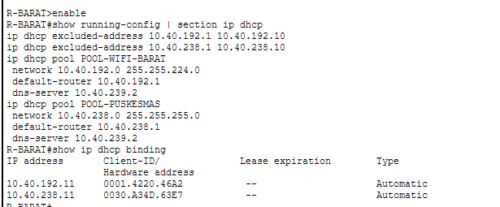
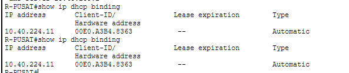
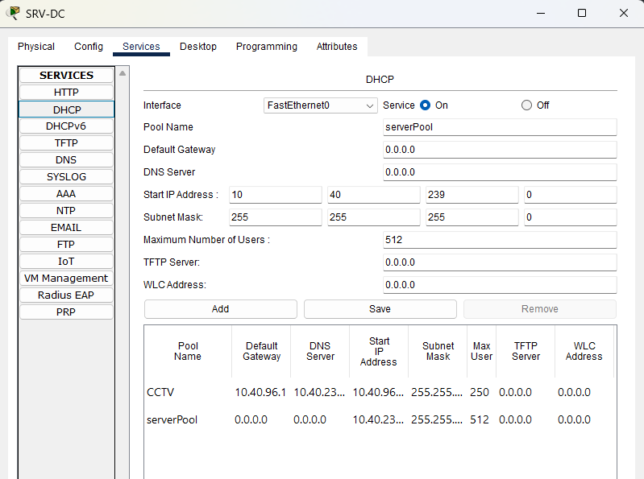
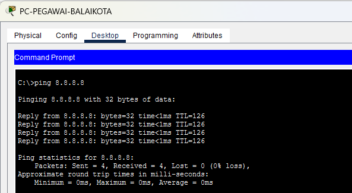
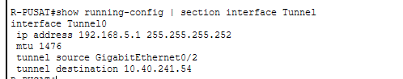
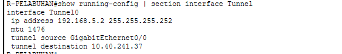
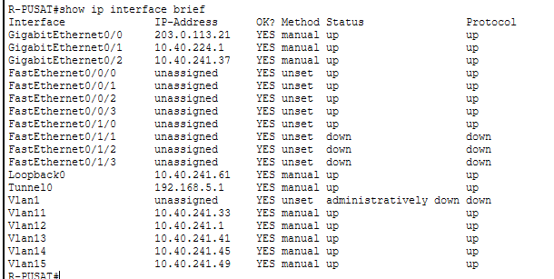
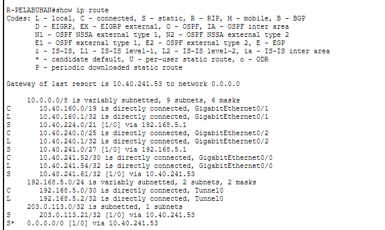
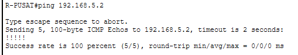

# ProjectJarkom_K5_037_042_097


## 6. Pengalamatan Dinamis (DHCP Server dan DHCP Relay)

Pada Bagian 2.3 draf Anggota 1, perangkat pengguna (PC kerja, laptop WiFi, dan kamera CCTV) sengaja belum diberi alamat IP statis. Pengalamatan seluruh perangkat tersebut diotomatisasi menggunakan protokol DHCP dengan dua metode:
1. **DHCP Server Lokal pada Router**: Melayani host pada LAN Pegawai Balai Kota, WiFi Publik Barat, dan Puskesmas.
2. **DHCP Relay pada Router & Server Terpusat**: Melayani kamera pengawas pada LAN CCTV Kota yang dialokasikan dari server Data Center (`SRV-DC`).

---

### 6.1 Konfigurasi DHCP Server Lokal pada Router

Router Cisco menyediakan layanan DHCP terintegrasi. Setiap pool dipetakan ke network LAN masing-masing, dengan reservasi 10 alamat IP pertama (`excluded-address`) untuk antarmuka gateway router, switch, maupun kebutuhan perangkat statis lain agar tidak terjadi konflik alamat IP (*IP conflict*).

#### A. Router R-PUSAT (LAN Pegawai Balai Kota)

Router `R-PUSAT` melayani pemberian alamat IP otomatis untuk komputer pegawai di Balai Kota pada segmen `10.40.224.0/21`:

```cisco
! Reservasi 10 IP pertama
ip dhcp excluded-address 10.40.224.1 10.40.224.10

! Konfigurasi pool pegawai Balai Kota
ip dhcp pool POOL-PEGAWAI
 network 10.40.224.0 255.255.248.0
 default-router 10.40.224.1
 dns-server 10.40.239.2
```

- `network 10.40.224.0 255.255.248.0`: Menyediakan rentang alamat IP subnet `/21` (kapasitas 2.046 host).
- `default-router 10.40.224.1`: Memberikan parameter Option 3 (*Default Gateway*) mengarah ke port `Gi0/1` R-PUSAT.
- `dns-server 10.40.239.2`: Mengarahkan resolusi nama domain ke server `SRV-DC`.

---

#### B. Router R-BARAT (WiFi Publik Barat dan Puskesmas)

Router `R-BARAT` mengelola dua pool terpisah untuk membedakan segmen publik dan instansi kesehatan:

```cisco
! Reservasi IP infrastruktur
ip dhcp excluded-address 10.40.192.1 10.40.192.10
ip dhcp excluded-address 10.40.238.1 10.40.238.10

! Pool layanan nirkabel WiFi Publik Barat
ip dhcp pool POOL-WIFI-BARAT
 network 10.40.192.0 255.255.224.0
 default-router 10.40.192.1
 dns-server 10.40.239.2

! Pool fasilitas kesehatan Puskesmas
ip dhcp pool POOL-PUSKESMAS
 network 10.40.238.0 255.255.255.0
 default-router 10.40.238.1
 dns-server 10.40.239.2
```

- Permintaan DHCP yang masuk melalui port `Gi0/1` (`10.40.192.1`) otomatis dialokasikan dari `POOL-WIFI-BARAT` (`/19`).
- Permintaan DHCP yang masuk melalui port `Gi0/2` (`10.40.238.1`) otomatis dialokasikan dari `POOL-PUSKESMAS` (`/24`).

---

### 6.2 Konfigurasi DHCP Relay Khusus CCTV (R-DC dan SRV-DC)

Kamera pengawas perkotaan (`PC-CCTV-KOTA`) berada di LAN `10.40.96.0/19` yang terhubung ke port `Gi0/1` router `R-DC`. Sesuai pembagian tugas, pengelolaan sewa IP CCTV dipusatkan pada server Data Center **`SRV-DC`** (`10.40.239.2`) di port `Gi0/2`.

Karena pesan *DHCP Discover* dikirimkan secara broadcast layer 2/3 (`255.255.255.255`), paket tersebut dibuang (*dropped*) oleh router `R-DC`. Router `R-DC` harus dikonfigurasi sebagai **DHCP Relay Agent** menggunakan perintah `ip helper-address`.

#### A. Konfigurasi Relay pada Router R-DC

```cisco
interface GigabitEthernet0/1
 ip address 10.40.96.1 255.255.224.0
 ip helper-address 10.40.239.2
 duplex auto
 speed auto
!
interface GigabitEthernet0/2
 ip address 10.40.239.1 255.255.255.0
 duplex auto
 speed auto
```

**Cara Kerja Relay:**
1. Klien CCTV memancarkan broadcast *DHCP Discover*.
2. Port `Gi0/1` mencegat paket broadcast dan mengubahnya menjadi paket **unicast** dengan tujuan `10.40.239.2` (`SRV-DC`).
3. `R-DC` menyisipkan alamat IP antarmuka penerimanya (`10.40.96.1`) ke dalam field **GIADDR** (*Gateway IP Address*).
4. `SRV-DC` membaca nilai GIADDR tersebut, mencocokkannya dengan pool `CCTV` (`10.40.96.0/19`), dan mengirimkan penawaran IP (*DHCP Offer*) kembali secara unicast ke `R-DC`.

#### B. Konfigurasi Layanan DHCP pada Server SRV-DC

Pada menu GUI **Services > DHCP** di `SRV-DC`:
- Service: **On**
- Pool Name: `CCTV`
- Default Gateway: `10.40.96.1`
- DNS Server: `10.40.239.2`
- Start IP Address: `10.40.96.0` (penyewaan host dimulai dari `10.40.96.11`)
- Subnet Mask: `255.255.224.0`
- Maximum Number of Users: `250`

---

### 6.3 Hasil Pengujian DHCP

Seluruh komputer pengguna berhasil memperoleh konfigurasi IP dinamis secara tepat tanpa adanya tumpang tindih.

| Perangkat Klien | Subnet LAN | IP Diperoleh | Gateway | DHCP Server | Keterangan Hasil |
| :--- | :--- | :--- | :--- | :--- | :--- |
| **PC-PEGAWAI-BALAIKOTA** | `10.40.224.0/21` | `10.40.224.11` | `10.40.224.1` | `10.40.224.1` (R-PUSAT) | Berhasil disewakan via DHCP lokal |
| **PC-PUSKESMAS** | `10.40.238.0/24` | `10.40.238.11` | `10.40.238.1` | `10.40.238.1` (R-BARAT) | Berhasil disewakan via DHCP lokal |
| **PC-CCTV-KOTA** | `10.40.96.0/19` | `10.40.96.11` | `10.40.96.1` | `10.40.239.2` (SRV-DC) | Berhasil disewakan via DHCP Relay |

#### Bukti Pengujian:

1. **Konfigurasi & Binding DHCP pada Router R-BARAT**:
   Menampilkan konfigurasi pool `POOL-WIFI-BARAT` dan `POOL-PUSKESMAS`. Tabel `show ip dhcp binding` mencatat IP `10.40.192.11` dan `10.40.238.11` terikat secara otomatis (*Automatic*).
   
   

2. **Konfigurasi Pool Pegawai pada Router R-PUSAT**:
   Konfigurasi `POOL-PEGAWAI` serta tabel sewa IP awal.

   

3. **Detail Status Binding pada Router R-PUSAT**:
   Memastikan MAC Address komputer pegawai (`00E0.A3B4.8363`) terikat aktif pada alamat `10.40.224.11`.

   

4. **Verifikasi `ipconfig /all` pada PC-PEGAWAI-BALAIKOTA**:
   Klien menerima IP `10.40.224.11`, netmask `255.255.248.0`, gateway `10.40.224.1`, dan DNS `10.40.239.2`.

   

5. **Verifikasi `ipconfig /all` pada PC-PUSKESMAS**:
   Klien menerima IP `10.40.238.11`, netmask `255.255.255.0`, gateway `10.40.238.1`, dan DNS `10.40.239.2`.

   

6. **Konfigurasi Service DHCP Pool CCTV pada SRV-DC**:
   Tampilan parameter service DHCP untuk subnet CCTV pada server Data Center.

   

7. **Konfigurasi `ip helper-address` pada Interface R-DC**:
   Potongan running-config antarmuka `Gi0/1` R-DC yang menjalankan peran DHCP Relay ke `10.40.239.2`.

  

8. **Verifikasi `ipconfig /all` pada PC-CCTV-KOTA (Pembuktian Relay)**:
   Klien CCTV memperoleh IP `10.40.96.11` dengan gateway `10.40.96.1`, dan field **DHCP Server** tertulis **`10.40.239.2`**. Ini membuktikan secara langsung bahwa paket DHCP berhasil diseberangkan lintas router dari Data Center.

  

---

## 7. Network Address Translation (NAT) untuk Akses 8.8.8.8

### 7.1 Alasan dan Konfigurasi NAT di R-PUSAT

Pada pengujian Bagian 4.4 draf Anggota 1, ping dari router `R-PUSAT` ke server internet `8.8.8.8` telah berhasil, namun pengujian dari PC pengguna belum bisa dilakukan. Hal ini disebabkan oleh:
- Seluruh host internal memakai alamat IPv4 privat RFC 1918 (`10.40.0.0/16`).
- Router `R-ISP` sengaja tidak memiliki tabel routing ke blok alamat privat `10.40.0.0/16`.

Agar paket balasan dari internet dapat kembali ke host pengirim, router `R-PUSAT` dikonfigurasi dengan **NAT Overload / PAT (Port Address Translation)** pada antarmuka uplink WAN:

```cisco
! 1. Interface luar (Outside) menghadap ke ISP
interface GigabitEthernet0/0
 ip address 203.0.113.21 255.255.255.252
 ip nat outside

! 2. Interface dalam (Inside) menghadap ke LAN Balai Kota dan Backbone
interface GigabitEthernet0/1
 ip address 10.40.224.1 255.255.248.0
 ip nat inside

interface GigabitEthernet0/2
 ip address 10.40.241.37 255.255.255.252
 ip nat inside

! 3. ACL mengidentifikasi seluruh subnet privat internal
access-list 1 permit 10.40.0.0 0.0.255.255

! 4. Translasi dinamis overload ke IP publik port Gi0/0
ip nat inside source list 1 interface GigabitEthernet0/0 overload

! 5. Default route keluar menuju ISP (melanjutkan Bagian 3.1 Anggota 1)
ip route 0.0.0.0 0.0.0.0 203.0.113.22
```

**Penjelasan Perintah:**
- `ip nat outside`: Menetapkan `Gi0/0` sebagai gerbang keluar publik menuju `R-ISP`.
- `ip nat inside`: Menetapkan antarmuka LAN lokal dan interkoneksi transit sebagai zona asal paket privat.
- `overload`: Mengizinkan seluruh perangkat privat berbagi satu alamat IP publik `203.0.113.21` dengan membedakan sesi berdasarkan port layer 4 dan identifier ICMP.

---

### 7.2 Hasil Pengujian NAT

Akses internet dari perangkat pengguna diuji dari `PC-PEGAWAI-BALAIKOTA` menuju `8.8.8.8`:

| Pengujian | Sumber | Tujuan | Hasil yang Diharapkan | Hasil Pengujian |
| :--- | :--- | :--- | :--- | :--- |
| `ping 8.8.8.8` | PC-PEGAWAI-BALAIKOTA (`10.40.224.11`) | `8.8.8.8` | Reply 4/4 (*0% loss*) | **Berhasil** |
| `show ip nat translations` | R-PUSAT CLI | N/A | Entri translasi `10.40.224.11` -> `203.0.113.21` tercatat | **Berhasil** |

#### Bukti Pengujian:

1. **Konfigurasi Interface NAT R-PUSAT**:
   Potongan running-config `R-PUSAT` membuktikan status `ip nat outside` pada `Gi0/0` serta `ip nat inside` pada `Gi0/1` dan `Gi0/2`.
   
   

2. **Uji Ping ke 8.8.8.8 dari PC Pegawai Balai Kota**:
   Empat paket ICMP dijawab lengkap dengan waktu tempuh `<1ms` dan `TTL=126`.
   
   

3. **Verifikasi Tabel `show ip nat translations` pada R-PUSAT**:
   Tabel membuktikan alamat **Inside Local** `10.40.224.11` ditranslasikan secara dinamis menjadi alamat **Inside Global** `203.0.113.21` untuk menjangkau destinasi **Outside Global** `8.8.8.8`.
   
   

---

## 8. GRE Tunnel antara Balai Kota dan Pelabuhan

### 8.1 Desain dan Konfigurasi Interface Tunnel0

Sesuai catatan Bagian 5 draf Anggota 1, penggantian `R-PUSAT` ke router Cisco 2911 (IOS 15.1) memungkinkan pembuatan antarmuka virtual `interface Tunnel0`. Jalur ini menghubungkan Balai Kota (`R-PUSAT`) dan Pelabuhan (`R-PELABUHAN`) secara *point-to-point* privat di atas infrastruktur transit yang ada.

#### Parameter Konfigurasi Tunnel0:

| Parameter | Router R-PUSAT (Balai Kota) | Router R-PELABUHAN (Pelabuhan) | Alasan Teknis |
| :--- | :--- | :--- | :--- |
| **Interface Virtual** | `Tunnel0` | `Tunnel0` | Port logis terowongan virtual GRE |
| **Alamat IP Tunnel** | `192.168.5.1 255.255.255.252` | `192.168.5.2 255.255.255.252` | Subnet `/30` Kelompok 5 ($K = 5$) |
| **MTU** | `1476` | `1476` | Mencegah fragmentasi akibat overhead GRE (24 byte) |
| **Tunnel Source** | `GigabitEthernet0/2` (atau IP `10.40.241.37`) | `GigabitEthernet0/0` (atau IP `10.40.241.54`) | Titik awal pengiriman paket underlay |
| **Tunnel Destination** | `10.40.241.54` (IP fisik R-PELABUHAN) | `10.40.241.37` (IP fisik R-PUSAT) | Titik akhir tujuan pengiriman paket underlay |

```cisco
! Konfigurasi di R-PUSAT
interface Tunnel0
 ip address 192.168.5.1 255.255.255.252
 mtu 1476
 tunnel source GigabitEthernet0/2
 tunnel destination 10.40.241.54

! Konfigurasi di R-PELABUHAN
interface Tunnel0
 ip address 192.168.5.2 255.255.255.252
 mtu 1476
 tunnel source GigabitEthernet0/0
 tunnel destination 10.40.241.37
```

**Alasan Penetapan MTU 1476 Byte:**
Ukuran MTU Ethernet standar adalah 1500 byte. GRE menambahkan header pembungkus sebesar 24 byte (20 byte IPv4 outer header + 4 byte GRE header). Mengatur MTU menjadi $1500 - 24 = 1476$ byte memastikan paket berukuran maksimal tidak mengalami pemotongan/fragmentasi (*IP fragmentation*) di sepanjang jalur transit.

---

### 8.2 Pembaruan Rute Statis Melintasi Tunnel (Penggantian Rute Anggota 1)

Pada Bagian 3.1 draf Anggota 1 tercatat:
> *"route R-PUSAT ke LAN Pelabuhan lewat R-UTARA (10.40.241.38) akan diganti ke tunnel GRE pada soal 6 (Anggota 2)."*

Sesuai instruksi tersebut, tabel routing statis diperbarui:

1. **Pembaruan di R-PUSAT**:
   Rute lama ke LAN Pelabuhan via next-hop R-UTARA (`10.40.241.38`) dialihkan ke next-hop IP Tunnel `192.168.5.2`:
   ```cisco
   ip route 10.40.160.0 255.255.224.0 192.168.5.2
   ip route 10.40.240.0 255.255.255.128 192.168.5.2
   ```

2. **Penambahan di R-PELABUHAN**:
   Rute spesifik menuju LAN Balai Kota diarahkan melalui next-hop IP Tunnel `192.168.5.1`:
   ```cisco
   ip route 10.40.224.0 255.255.248.0 192.168.5.1
   ip route 10.40.241.0 255.255.255.224 192.168.5.1
   ```

Dengan konfigurasi ini, seluruh paket data antara Balai Kota dan Pelabuhan langsung masuk ke terowongan enkapsulasi GRE tanpa melalui pemrosesan routing biasa di router perantara `R-UTARA`.

---

### 8.3 Hasil Pengujian GRE Tunnel

| No | Pengujian | Titik Uji | Target | Hasil yang Diharapkan | Hasil |
| :--- | :--- | :--- | :--- | :--- | :--- |
| 1 | Status Antarmuka Tunnel0 | R-PUSAT & R-PELABUHAN | `Tunnel0` | Status `up/up` | **Berhasil** |
| 2 | Ping Antar-Endpoint Tunnel | R-PUSAT CLI | `192.168.5.2` | Reply 5/5 (`!!!!!`) | **Berhasil** |
| 3 | Ping Antar-Endpoint Tunnel | R-PELABUHAN CLI | `192.168.5.1` | Reply 5/5 (`!!!!!`) | **Berhasil** |
| 4 | Verifikasi Rute Overlay | R-PUSAT & R-PELABUHAN | `show ip route` | Prefix diarahkan via IP Tunnel | **Berhasil** |
| 5 | Ping End-to-End Antar-LAN | PC Balai Kota (`10.40.224.11`) | PC Pelabuhan (`10.40.160.11`) | Reply 4/4 (*0% loss*) | **Berhasil** |
| 6 | Traceroute Enkapsulasi | PC Balai Kota (`10.40.224.11`) | PC Pelabuhan (`10.40.160.11`) | Hop 2 langsung IP Tunnel `192.168.5.2` | **Berhasil** |

#### Bukti Pengujian:

1. **Konfigurasi Interface Tunnel0 pada R-PUSAT**:
   Running-config antarmuka Tunnel0 dengan IP `192.168.5.1/30` dan MTU `1476`.

   

2. **Konfigurasi Interface Tunnel0 pada R-PELABUHAN**:
   Running-config antarmuka Tunnel0 dengan IP `192.168.5.2/30` dan MTU `1476`.

   

3. **Status Antarmuka Brief pada R-PUSAT**:
   Menunjukkan `Tunnel0` berstatus aktif normal (**up/up**).

   

4. **Status Antarmuka Brief pada R-PELABUHAN**:
   Menunjukkan `Tunnel0` berstatus aktif normal (**up/up**).

   

5. **Tabel Routing R-PUSAT Membuktikan Rute via Tunnel**:
   Output `show ip route` membuktikan rute `10.40.160.0/19` dan `10.40.240.0/25` diarahkan via `192.168.5.2`.

   

6. **Tabel Routing R-PELABUHAN Membuktikan Rute via Tunnel**:
   Output `show ip route` membuktikan rute `10.40.224.0/21` diarahkan via `192.168.5.1`.
   
   

7. **Ping Tunnel dari R-PUSAT ke R-PELABUHAN (`192.168.5.2`)**:
   Tingkat keberhasilan 100% (5/5 paket balasan diterima).
   
   

8. **Ping Tunnel dari R-PELABUHAN ke R-PUSAT (`192.168.5.1`)**:
   Tingkat keberhasilan 100% (5/5 paket balasan diterima).
   
   

9. **Ping End-to-End dari PC Balai Kota ke PC Pelabuhan (`10.40.160.11`)**:
   Komunikasi antar komputer pengguna lintas pulau/kantor berhasil tanpa packet loss.

   

10. **Traceroute Membuktikan Jalur GRE Tunnel**:
    Eksekusi `tracert 10.40.160.11` dari `PC-PEGAWAI-BALAIKOTA`:
    
    

    ```text
    C:\>tracert 10.40.160.11

    Tracing route to 10.40.160.11 over a maximum of 30 hops:

      1   0 ms      0 ms      0 ms      10.40.224.1
      2   0 ms      0 ms      0 ms      192.168.5.2
      3   0 ms      0 ms      1 ms      10.40.160.11

    Trace complete.
    ```
