# Laporan Mid-Project Jarkom - Kelompok 5

| Anggota | Nama                   | NRP        | Bagian                                                                  |
| ------- | ---------------------- | ---------- | ----------------------------------------------------------------------- |
| 1       | Nayla Arsha Adyuta     | 5027251042 | Topologi, tabel subnetting, IP statis, static routing dan default route |
| 2       | Sahira Bilqis Rivadito | 5027251037 | DHCP, NAT, Tunnel GRE                                                   |
| 3       | Salman Rifki Haq       | 5027251097 | Layanan aplikasi (DNS, web, FTP, email), OSPF                           |

## 1. Perancangan Topologi

### 1.1 Gambar topologi dan skema yang dipilih

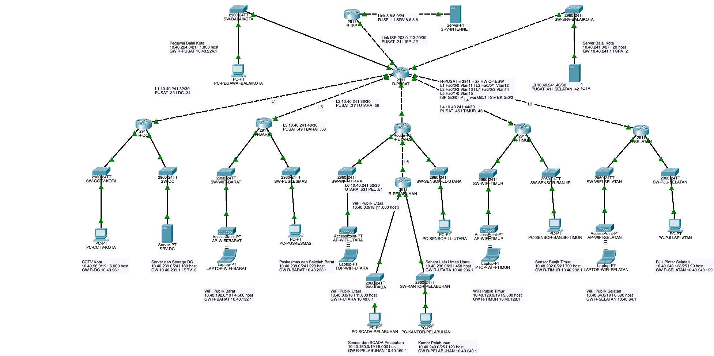

_Gambar: Topologi lengkap di Cisco Packet Tracer (file `K5_VLSM.pkt`)._

**Skema: VLSM** (blok 10.40.0.0/16, K = 5).

**Blok alamat.** Aturan soal: oktet ke-2 = 8 x nomor kelompok, sehingga untuk K = 5 oktet ke-2 adalah 40 dan blok dasarnya `10.40.0.0`. Blok privat `10.0.0.0/8` dipilih karena hanya blok 10.x.x.x yang bisa memakai aturan oktet ke-2 = 8 x K, dan kapasitasnya (16,7 juta alamat) cukup untuk VLSM maupun CIDR. Blok `192.168.0.0/16` hanya 65.536 alamat, dan `172.16.0.0/12` tidak punya oktet ke-2 yang bisa diatur dengan aturan tersebut.

**Alasan memilih VLSM.** Kebutuhan host tiap LAN sangat berbeda (dari 20 sampai 11.000 host). VLSM mengalokasikan blok sesuai kebutuhan tiap subnet sehingga seluruh jaringan muat di satu blok /16 (65.536 alamat) dengan pemakaian **64,21%** (42.080 host kebutuhan). Dengan CIDR, tiap router dibulatkan ke blok pangkat 2 lalu digabung, sehingga butuh blok /14 (262.144 alamat) dengan pemakaian hanya **16,05%**. Perhitungan lengkap ada di spreadsheet (sheet _Efisiensi_).

| Perbandingan                         | VLSM       | CIDR    |
| :----------------------------------- | :--------- | :------ |
| Host kebutuhan                       | 42.080     | 42.080  |
| Total ukuran blok yang dialokasikan  | 61.752     | 135.168 |
| Prefix terkecil yang menampung semua | /16        | /14     |
| Total alamat pada prefix tersebut    | 65.536     | 262.144 |
| Persentase pemakaian                 | **64,21%** | 16,05%  |
| Alamat terbuang                      | 23.456     | 220.064 |

### 1.2 Backbone (mengikuti Gambar 1)

| Link     | Router A | Router B               | Jaringan        | Media            |
| :------- | :------- | :--------------------- | :-------------- | :--------------- |
| L1       | R-PUSAT  | R-DC                   | 10.40.241.32/30 | Kabel cross-over |
| L2       | R-PUSAT  | R-UTARA                | 10.40.241.36/30 | Kabel cross-over |
| L3       | R-PUSAT  | R-SELATAN              | 10.40.241.40/30 | Kabel cross-over |
| L4       | R-PUSAT  | R-TIMUR                | 10.40.241.44/30 | Kabel cross-over |
| L5       | R-PUSAT  | R-BARAT                | 10.40.241.48/30 | Kabel cross-over |
| L6       | R-UTARA  | R-PELABUHAN            | 10.40.241.52/30 | Kabel cross-over |
| R-ISP    | R-PUSAT  | R-ISP                  | 203.0.113.20/30 | Kabel cross-over |
| Internet | R-ISP    | SRV-INTERNET (8.8.8.8) | 8.8.8.0/24      | Kabel cross-over |

Kabel cross-over dipakai karena menghubungkan perangkat sejenis (router ke router, router ke server). Link L7 (cadangan) **tidak** dipasang di file utama; itu bagian file OSPF.

### 1.3 Desain tiap LAN dan alasannya

| Router      | LAN                         | Switch              | Perangkat wakil                                | Media    | Alasan                                                                                                                                                |
| :---------- | :-------------------------- | :------------------ | :--------------------------------------------- | :------- | :---------------------------------------------------------------------------------------------------------------------------------------------------- |
| R-DC        | CCTV Kota                   | SW-CCTV-KOTA        | PC-CCTV-KOTA (PC (mewakili kamera CCTV))       | Kabel    | CCTV tetap dan butuh bandwidth stabil untuk video, jadi kabel; PC mewakili kamera.                                                                    |
| R-UTARA     | WiFi Publik Utara           | SW-WIFI-UTARA       | LAPTOP-WIFI-UTARA (Laptop + AP-WIFI-UTARA)     | Wireless | Layanan publik berbasis nirkabel; 1 AP + perangkat mobile mewakili pengguna, switch membuat port router cukup 1 per LAN dan memudahkan penambahan AP. |
| R-UTARA     | Sensor Lalu Lintas Utara    | SW-SENSOR-LL-UTARA  | PC-SENSOR-LL-UTARA (PC (mewakili sensor))      | Kabel    | Sensor di lokasi tetap, kabel lebih stabil dan tidak bergantung sinyal; PC mewakili sensor.                                                           |
| R-SELATAN   | WiFi Publik Selatan         | SW-WIFI-SELATAN     | LAPTOP-WIFI-SELATAN (Laptop + AP-WIFI-SELATAN) | Wireless | Sama seperti WiFi Utara: akses publik nirkabel lewat AP.                                                                                              |
| R-SELATAN   | PJU Pintar Selatan          | SW-PJU-SELATAN      | PC-PJU-SELATAN (PC (mewakili PJU pintar))      | Kabel    | Perangkat tetap, kabel; PC mewakili PJU pintar.                                                                                                       |
| R-TIMUR     | WiFi Publik Timur           | SW-WIFI-TIMUR       | LAPTOP-WIFI-TIMUR (Laptop + AP-WIFI-TIMUR)     | Wireless | Sama seperti WiFi Utara: akses publik nirkabel lewat AP.                                                                                              |
| R-TIMUR     | Sensor Banjir Timur         | SW-SENSOR-BANJIR    | PC-SENSOR-BANJIR-TIMUR (PC (mewakili sensor))  | Kabel    | Sensor di lokasi tetap, kabel lebih stabil; PC mewakili sensor.                                                                                       |
| R-BARAT     | WiFi Publik Barat           | SW-WIFI-BARAT       | LAPTOP-WIFI-BARAT (Laptop + AP-WIFI-BARAT)     | Wireless | Sama seperti WiFi Utara: akses publik nirkabel lewat AP.                                                                                              |
| R-BARAT     | Puskesmas dan Sekolah Barat | SW-PUSKESMAS        | PC-PUSKESMAS (PC)                              | Kabel    | Perangkat kerja tetap, kabel.                                                                                                                         |
| R-PUSAT     | Pegawai Balai Kota          | SW-BALAIKOTA        | PC-PEGAWAI-BALAIKOTA (PC (pegawai))            | Kabel    | Komputer pegawai, kabel.                                                                                                                              |
| R-PELABUHAN | Sensor dan SCADA Pelabuhan  | SW-SCADA            | PC-SCADA-PELABUHAN (PC (mewakili SCADA))       | Kabel    | SCADA butuh koneksi andal, jadi kabel; PC mewakili perangkat SCADA.                                                                                   |
| R-PELABUHAN | Kantor Pelabuhan            | SW-KANTOR-PELABUHAN | PC-KANTOR-PELABUHAN (PC (pegawai))             | Kabel    | Komputer pegawai, kabel.                                                                                                                              |
| R-DC        | Server dan Storage DC       | SW-DC               | SRV-DC (Server)                                | Kabel    | Server ditaruh di LAN sendiri dengan switch agar layanan tambahan mudah dipasang.                                                                     |
| R-PUSAT     | Server Balai Kota           | SW-SRV-BALAIKOTA    | SRV-BALAIKOTA (Server)                         | Kabel    | Server ditaruh di LAN sendiri dengan switch agar layanan tambahan mudah dipasang.                                                                     |

### 1.4 Pemilihan router dan penambahan port

| Router      | Jumlah port yang dipakai | Model                    | Alasan                                                                                                                                                                                                                                 |
| :---------- | :----------------------- | :----------------------- | :------------------------------------------------------------------------------------------------------------------------------------------------------------------------------------------------------------------------------------- |
| R-PUSAT     | 8                        | 2911 (+ 2x HWIC-4ESW)    | Butuh 8 port (3 Gigabit bawaan untuk ISP dan 2 LAN, 5 port Fast Ethernet dari 2 modul HWIC-4ESW untuk link L1-L5). Model 2911 (IOS 15.1) dipilih karena mendukung `interface Tunnel` untuk GRE (soal 6); Router-PT tidak mendukungnya. |
| R-UTARA     | 4                        | Router-PT (+ modul port) | Butuh lebih dari 3 port Gigabit bawaan 2911, jadi dipakai router modular dengan modul tambahan.                                                                                                                                        |
| R-DC        | 3                        | 2911                     | Cukup dengan 3 port Gigabit bawaan.                                                                                                                                                                                                    |
| R-SELATAN   | 3                        | 2911                     | Cukup dengan 3 port Gigabit bawaan.                                                                                                                                                                                                    |
| R-TIMUR     | 3                        | 2911                     | Cukup dengan 3 port Gigabit bawaan.                                                                                                                                                                                                    |
| R-BARAT     | 3                        | 2911                     | Cukup dengan 3 port Gigabit bawaan.                                                                                                                                                                                                    |
| R-PELABUHAN | 3                        | 2911                     | Cukup dengan 3 port Gigabit bawaan.                                                                                                                                                                                                    |
| R-ISP       | 2                        | 2911                     | Cukup dengan 3 port Gigabit bawaan.                                                                                                                                                                                                    |

### 1.5 Nama perangkat dan label subnet

Semua nama bawaan sudah diganti (contoh: `R-PUSAT`, `SW-BALAIKOTA`, `PC-CCTV-KOTA`). Tiap LAN diberi label nama subnet, Network ID/prefix, dan jumlah host:

| LAN                         | Network ID/Prefix | Jumlah host |
| :-------------------------- | :---------------- | :---------- |
| WiFi Publik Utara           | 10.40.0.0/18      | 11.000      |
| WiFi Publik Selatan         | 10.40.64.0/19     | 6.500       |
| CCTV Kota                   | 10.40.96.0/19     | 6.000       |
| WiFi Publik Timur           | 10.40.128.0/19    | 5.500       |
| Sensor dan SCADA Pelabuhan  | 10.40.160.0/19    | 5.000       |
| WiFi Publik Barat           | 10.40.192.0/19    | 4.500       |
| Pegawai Balai Kota          | 10.40.224.0/21    | 1.800       |
| Sensor Banjir Timur         | 10.40.232.0/22    | 700         |
| Sensor Lalu Lintas Utara    | 10.40.236.0/23    | 450         |
| Puskesmas dan Sekolah Barat | 10.40.238.0/24    | 220         |
| Server dan Storage DC       | 10.40.239.0/24    | 180         |
| Kantor Pelabuhan            | 10.40.240.0/25    | 120         |
| PJU Pintar Selatan          | 10.40.240.128/25  | 90          |
| Server Balai Kota           | 10.40.241.0/27    | 20          |

## 2. Pengalamatan IP Statis

### 2.1 Interface router

| Router      | Port                  | Tersambung ke                   | IP            | Mask            | Jaringan         |
| :---------- | :-------------------- | :------------------------------ | :------------ | :-------------- | :--------------- |
| R-PUSAT     | Gi0/0                 | Link ke R-ISP (IP publik)       | 203.0.113.21  | 255.255.255.252 | 203.0.113.20/30  |
| R-PUSAT     | Gi0/1                 | LAN Pegawai Balai Kota          | 10.40.224.1   | 255.255.248.0   | 10.40.224.0/21   |
| R-PUSAT     | Gi0/2                 | L2 ke R-UTARA                   | 10.40.241.37  | 255.255.255.252 | 10.40.241.36/30  |
| R-PUSAT     | Vlan11 (port Fa0/0/0) | L1 ke R-DC                      | 10.40.241.33  | 255.255.255.252 | 10.40.241.32/30  |
| R-PUSAT     | Vlan12 (port Fa0/0/1) | LAN Server Balai Kota           | 10.40.241.1   | 255.255.255.224 | 10.40.241.0/27   |
| R-PUSAT     | Vlan13 (port Fa0/0/2) | L3 ke R-SELATAN                 | 10.40.241.41  | 255.255.255.252 | 10.40.241.40/30  |
| R-PUSAT     | Vlan14 (port Fa0/0/3) | L4 ke R-TIMUR                   | 10.40.241.45  | 255.255.255.252 | 10.40.241.44/30  |
| R-PUSAT     | Vlan15 (port Fa0/1/0) | L5 ke R-BARAT                   | 10.40.241.49  | 255.255.255.252 | 10.40.241.48/30  |
| R-UTARA     | Gi9/0                 | L2 ke R-PUSAT                   | 10.40.241.38  | 255.255.255.252 | 10.40.241.36/30  |
| R-UTARA     | Gi6/0                 | L6 ke R-PELABUHAN               | 10.40.241.53  | 255.255.255.252 | 10.40.241.52/30  |
| R-UTARA     | Gi8/0                 | LAN WiFi Publik Utara           | 10.40.0.1     | 255.255.192.0   | 10.40.0.0/18     |
| R-UTARA     | Gi7/0                 | LAN Sensor Lalu Lintas Utara    | 10.40.236.1   | 255.255.254.0   | 10.40.236.0/23   |
| R-DC        | Gi0/0                 | L1 ke R-PUSAT                   | 10.40.241.34  | 255.255.255.252 | 10.40.241.32/30  |
| R-DC        | Gi0/1                 | LAN CCTV Kota                   | 10.40.96.1    | 255.255.224.0   | 10.40.96.0/19    |
| R-DC        | Gi0/2                 | LAN Server dan Storage DC       | 10.40.239.1   | 255.255.255.0   | 10.40.239.0/24   |
| R-SELATAN   | Gi0/0                 | L3 ke R-PUSAT                   | 10.40.241.42  | 255.255.255.252 | 10.40.241.40/30  |
| R-SELATAN   | Gi0/1                 | LAN WiFi Publik Selatan         | 10.40.64.1    | 255.255.224.0   | 10.40.64.0/19    |
| R-SELATAN   | Gi0/2                 | LAN PJU Pintar Selatan          | 10.40.240.129 | 255.255.255.128 | 10.40.240.128/25 |
| R-TIMUR     | Gi0/0                 | L4 ke R-PUSAT                   | 10.40.241.46  | 255.255.255.252 | 10.40.241.44/30  |
| R-TIMUR     | Gi0/1                 | LAN WiFi Publik Timur           | 10.40.128.1   | 255.255.224.0   | 10.40.128.0/19   |
| R-TIMUR     | Gi0/2                 | LAN Sensor Banjir Timur         | 10.40.232.1   | 255.255.252.0   | 10.40.232.0/22   |
| R-BARAT     | Gi0/0                 | L5 ke R-PUSAT                   | 10.40.241.50  | 255.255.255.252 | 10.40.241.48/30  |
| R-BARAT     | Gi0/1                 | LAN WiFi Publik Barat           | 10.40.192.1   | 255.255.224.0   | 10.40.192.0/19   |
| R-BARAT     | Gi0/2                 | LAN Puskesmas dan Sekolah Barat | 10.40.238.1   | 255.255.255.0   | 10.40.238.0/24   |
| R-PELABUHAN | Gi0/0                 | L6 ke R-UTARA                   | 10.40.241.54  | 255.255.255.252 | 10.40.241.52/30  |
| R-PELABUHAN | Gi0/1                 | LAN Sensor dan SCADA Pelabuhan  | 10.40.160.1   | 255.255.224.0   | 10.40.160.0/19   |
| R-PELABUHAN | Gi0/2                 | LAN Kantor Pelabuhan            | 10.40.240.1   | 255.255.255.128 | 10.40.240.0/25   |
| R-ISP       | Gi0/0                 | Link ke R-PUSAT (IP publik)     | 203.0.113.22  | 255.255.255.252 | 203.0.113.20/30  |
| R-ISP       | Gi0/1                 | Ke Server 8.8.8.8               | 8.8.8.1       | 255.255.255.0   | 8.8.8.0/24       |

Gateway tiap LAN = alamat host pertama. Pada link /30, router yang lebih dekat ke R-PUSAT mendapat host pertama.

Catatan penamaan port:

- **R-PUSAT** memakai 2911 dengan 2 modul HWIC-4ESW. Port modul adalah port switch Fast Ethernet, jadi tiap link L1-L5 ditaruh di satu VLAN sendiri (VLAN 11 sampai 15) dan alamat IP dipasang di `interface VlanXX` yang berfungsi seperti port routed. Penjelasan lengkap ada di bagian 5.
- **R-UTARA** memakai Router-PT sehingga port bernomor `Gi6/0` sampai `Gi9/0` (nomor menurut slot modul di Packet Tracer).
- Router lain memakai 2911 dengan port bawaan `Gi0/0` sampai `Gi0/2`.

### 2.2 Server

| Server        | IP          | Mask            | Gateway     | DNS         |
| :------------ | :---------- | :-------------- | :---------- | :---------- |
| SRV-INTERNET  | 8.8.8.8     | 255.255.255.0   | 8.8.8.1     | -           |
| SRV-DC        | 10.40.239.2 | 255.255.255.0   | 10.40.239.1 | 10.40.239.2 |
| SRV-BALAIKOTA | 10.40.241.2 | 255.255.255.224 | 10.40.241.1 | 10.40.239.2 |

DNS server pada SRV-DC dan SRV-BALAIKOTA menunjuk ke SRV-DC (layanan DNS-nya dikonfigurasi Anggota 3). SRV-INTERNET tidak memakai DNS.

### 2.3 Perangkat pengguna

PC wakil dan perangkat WiFi **tidak diberi IP statis**: seluruhnya memakai DHCP (router untuk semua LAN, kecuali LAN CCTV Kota yang dilayani server DHCP di SRV-DC). Konfigurasi DHCP adalah bagian Anggota 2. Hasil pengalamatan dinamis dijelaskan pada Bagian 6 (Anggota 2).

### 2.4 Konfigurasi dasar tiap router

Contoh konfigurasi `R-DC` (router 2911). Router lain memakai pola yang sama, hanya alamat dan nama interface yang berbeda.

```cisco
enable
configure terminal
hostname R-DC
no ip domain-lookup
!
interface GigabitEthernet0/0
 description L1 ke R-PUSAT
 ip address 10.40.241.34 255.255.255.252
 no shutdown
!
interface GigabitEthernet0/1
 description LAN CCTV Kota
 ip address 10.40.96.1 255.255.224.0
 no shutdown
!
interface GigabitEthernet0/2
 description LAN Server dan Storage DC
 ip address 10.40.239.1 255.255.255.0
 no shutdown
!
ip route 0.0.0.0 0.0.0.0 10.40.241.33
end
write memory
```

| Perintah                              | Fungsi                                                                  |
| :------------------------------------ | :---------------------------------------------------------------------- |
| `hostname R-DC`                       | Mengganti nama router agar menunjukkan lokasinya                        |
| `no ip domain-lookup`                 | Mencegah router menunggu DNS saat salah ketik perintah                  |
| `interface ...` + `description`       | Masuk ke interface dan memberi keterangan (link atau LAN yang dilayani) |
| `ip address <IP> <mask>`              | Memberi IP statis. Untuk LAN, IP ini adalah gateway (host pertama)      |
| `no shutdown`                         | Mengaktifkan interface (secara bawaan interface router mati)            |
| `ip route 0.0.0.0 0.0.0.0 <next hop>` | Default route ke router di atasnya                                      |
| `write memory`                        | Menyimpan konfigurasi ke NVRAM agar tidak hilang saat router restart    |

### 2.5 Konfigurasi khusus R-PUSAT (2911 + HWIC-4ESW)

`R-PUSAT` butuh 8 port: 3 port Gigabit bawaan (ISP, LAN Pegawai, dan link L2 ke R-UTARA), serta 5 port dari dua modul HWIC-4ESW (link L1, L3, L4, L5, dan LAN Server). Port modul adalah port switch, sehingga tiap port ditaruh di VLAN sendiri dan IP dipasang di `interface VlanXX`.

```cisco
enable
vlan database
 vlan 11
 vlan 12
 vlan 13
 vlan 14
 vlan 15
 exit
configure terminal
hostname R-PUSAT
!
interface FastEthernet0/0/0
 switchport mode access
 switchport access vlan 11
 no shutdown
! (Fa0/0/1 -> vlan 12 (LAN Server), Fa0/0/2 -> vlan 13, Fa0/0/3 -> vlan 14, Fa0/1/0 -> vlan 15)
!
interface Vlan11
 description L1 ke R-DC
 ip address 10.40.241.33 255.255.255.252
 no shutdown
! (Vlan13 .41, Vlan14 .45, Vlan15 .49 dengan pola yang sama)
!
interface Vlan12
 description LAN Server Balai Kota
 ip address 10.40.241.1 255.255.255.224
 no shutdown
!
interface GigabitEthernet0/0
 description Link ke R-ISP (IP publik)
 ip address 203.0.113.21 255.255.255.252
 no shutdown
!
interface GigabitEthernet0/1
 description LAN Pegawai Balai Kota
 ip address 10.40.224.1 255.255.248.0
 no shutdown
!
interface GigabitEthernet0/2
 description L2 ke R-UTARA
 ip address 10.40.241.37 255.255.255.252
 no shutdown
```

Dengan satu port per VLAN, tiap interface VLAN berperilaku seperti port router biasa. Konfigurasi DHCP dan NAT pada `R-PUSAT` dijelaskan pada Bagian 6 dan 7 (Anggota 2). Alasan `R-PUSAT` memakai 2911 (bukan Router-PT) dijelaskan pada Bagian 5.

## 3. Static Routing dan Default Route

**Aturan dari soal:** semua LAN saling terhubung hanya dengan static route; default route hanya menuju router di atasnya (arah keluar); R-PUSAT dan R-UTARA wajib punya static route ke jaringan di bawahnya.

### 3.1 Penjelasan per router

#### R-PUSAT

Pusat jaringan. Punya static route ke semua LAN milik R-DC, R-UTARA, R-PELABUHAN, R-SELATAN, R-TIMUR, dan R-BARAT, plus route ke link L6 agar tunnel GRE (soal 6) nanti punya tujuan yang terjangkau. Default route ke R-ISP untuk akses keluar.

| Tujuan        | Mask            | Next hop     | Keterangan                                                            |
| :------------ | :-------------- | :----------- | :-------------------------------------------------------------------- |
| 10.40.96.0    | 255.255.224.0   | 10.40.241.34 | LAN CCTV Kota via R-DC                                                |
| 10.40.239.0   | 255.255.255.0   | 10.40.241.34 | LAN Server dan Storage DC via R-DC                                    |
| 10.40.0.0     | 255.255.192.0   | 10.40.241.38 | LAN WiFi Publik Utara via R-UTARA                                     |
| 10.40.236.0   | 255.255.254.0   | 10.40.241.38 | LAN Sensor Lalu Lintas Utara via R-UTARA                              |
| 10.40.64.0    | 255.255.224.0   | 10.40.241.42 | LAN WiFi Publik Selatan via R-SELATAN                                 |
| 10.40.240.128 | 255.255.255.128 | 10.40.241.42 | LAN PJU Pintar Selatan via R-SELATAN                                  |
| 10.40.128.0   | 255.255.224.0   | 10.40.241.46 | LAN WiFi Publik Timur via R-TIMUR                                     |
| 10.40.232.0   | 255.255.252.0   | 10.40.241.46 | LAN Sensor Banjir Timur via R-TIMUR                                   |
| 10.40.192.0   | 255.255.224.0   | 10.40.241.50 | LAN WiFi Publik Barat via R-BARAT                                     |
| 10.40.238.0   | 255.255.255.0   | 10.40.241.50 | LAN Puskesmas dan Sekolah Barat via R-BARAT                           |
| 10.40.160.0   | 255.255.224.0   | 10.40.241.38 | LAN Sensor dan SCADA Pelabuhan via R-UTARA (diganti tunnel di soal 6) |
| 10.40.240.0   | 255.255.255.128 | 10.40.241.38 | LAN Kantor Pelabuhan via R-UTARA (diganti tunnel di soal 6)           |
| 10.40.241.52  | 255.255.255.252 | 10.40.241.38 | link L6 (dibutuhkan agar tunnel destination terjangkau)               |
| 0.0.0.0       | 0.0.0.0         | 203.0.113.22 | default route ke R-ISP                                                |

#### R-UTARA

Punya static route ke LAN milik R-PELABUHAN (di bawahnya, lewat L6). Default route ke R-PUSAT untuk semua tujuan lain.

| Tujuan      | Mask            | Next hop     | Keterangan                                     |
| :---------- | :-------------- | :----------- | :--------------------------------------------- |
| 10.40.160.0 | 255.255.224.0   | 10.40.241.54 | LAN Sensor dan SCADA Pelabuhan via R-PELABUHAN |
| 10.40.240.0 | 255.255.255.128 | 10.40.241.54 | LAN Kantor Pelabuhan via R-PELABUHAN           |
| 0.0.0.0     | 0.0.0.0         | 10.40.241.37 | default route ke R-PUSAT                       |

#### R-DC

Tidak punya router di bawahnya, jadi cukup default route ke R-PUSAT.

| Tujuan  | Mask    | Next hop     | Keterangan               |
| :------ | :------ | :----------- | :----------------------- |
| 0.0.0.0 | 0.0.0.0 | 10.40.241.33 | default route ke R-PUSAT |

#### R-SELATAN

Tidak punya router di bawahnya, jadi cukup default route ke R-PUSAT.

| Tujuan  | Mask    | Next hop     | Keterangan               |
| :------ | :------ | :----------- | :----------------------- |
| 0.0.0.0 | 0.0.0.0 | 10.40.241.41 | default route ke R-PUSAT |

#### R-TIMUR

Tidak punya router di bawahnya, jadi cukup default route ke R-PUSAT.

| Tujuan  | Mask    | Next hop     | Keterangan               |
| :------ | :------ | :----------- | :----------------------- |
| 0.0.0.0 | 0.0.0.0 | 10.40.241.45 | default route ke R-PUSAT |

#### R-BARAT

Tidak punya router di bawahnya, jadi cukup default route ke R-PUSAT.

| Tujuan  | Mask    | Next hop     | Keterangan               |
| :------ | :------ | :----------- | :----------------------- |
| 0.0.0.0 | 0.0.0.0 | 10.40.241.49 | default route ke R-PUSAT |

#### R-PELABUHAN

Berada di bawah R-UTARA, jadi hanya default route ke R-UTARA.

| Tujuan  | Mask    | Next hop     | Keterangan               |
| :------ | :------ | :----------- | :----------------------- |
| 0.0.0.0 | 0.0.0.0 | 10.40.241.53 | default route ke R-UTARA |

R-ISP sengaja tidak punya route ke alamat privat (syarat soal 5).

**Catatan:** route R-PUSAT ke LAN Pelabuhan lewat R-UTARA (10.40.241.38) akan diganti ke tunnel GRE pada soal 6 (Anggota 2).

### 3.2 Sintaks static route dan default route

```cisco
! static route ke jaringan di bawah router
ip route <network tujuan> <subnet mask> <next hop>
! contoh di R-PUSAT: LAN CCTV Kota lewat R-DC
ip route 10.40.96.0 255.255.224.0 10.40.241.34
! default route ke router di atasnya
ip route 0.0.0.0 0.0.0.0 203.0.113.22
```

- `next hop` adalah alamat interface router tetangga yang berada satu link dengan router ini.
- Default route (`0.0.0.0 0.0.0.0`) dipakai untuk semua tujuan yang tidak ada di tabel routing, dan hanya diarahkan ke router di atasnya (arah keluar).
- Static route hanya dipasang di router yang punya jaringan di bawahnya (`R-PUSAT` dan `R-UTARA`).
- Pada `show ip route`: kode `C` = connected, `L` = alamat lokal interface, `S` = static, `S*` = default route.

## 4. Hasil Pengujian

Semua pengujian dijalankan dari CLI router di Packet Tracer dengan perintah `ping`. Hasil `Berhasil` berarti 5 dari 5 paket balasan diterima (`!!!!!`); satu titik di awal (`.!!!!`) pada percobaan pertama itu normal karena proses ARP.

### 4.1 Interface dan tabel routing

- Alamat IP seluruh interface router dan server sudah sesuai tabel pada bagian 2 (semua interface berstatus `up/up`).
- Tabel routing tiap router sesuai bagian 3. Contoh `show ip route` di R-PUSAT: route static ke seluruh LAN cabang dan link router lain, route connected (Gi0/0, Gi0/1, Gi0/2, dan Vlan11 sampai Vlan15), serta default route `S* 0.0.0.0/0 via 203.0.113.22`. Route ke LAN Pelabuhan memakai next hop tunnel GRE `192.168.5.2` (Bagian 8).

#### Bukti Pengujian:

1. **`show ip interface brief` pada R-PUSAT**:
   Menampilkan `Gi0/0`, `Gi0/1`, `Gi0/2`, dan `Vlan11` sampai `Vlan15` dengan IP sesuai tabel dan status `up/up` (juga `Loopback0` dan `Tunnel0` tambahan dari Anggota 2).

   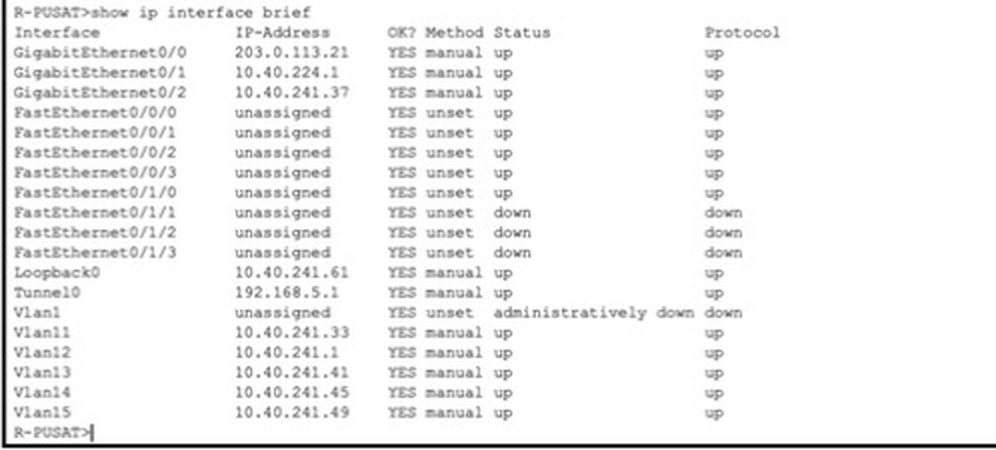

2. **`show ip interface brief` pada R-UTARA**:
   Menampilkan `Gi6/0` sampai `Gi9/0` dengan status `up/up`.

   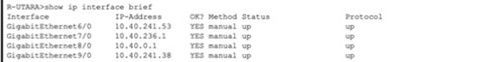

3. **`show ip route` pada R-PUSAT**:
   Menampilkan route static ke seluruh LAN cabang dan default route ke R-ISP.

   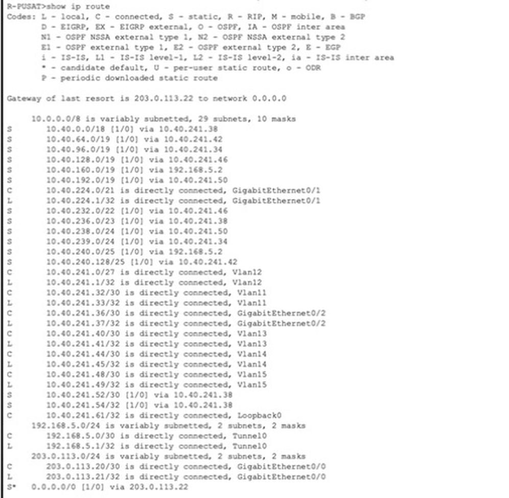

4. **`show ip route` pada R-UTARA**:
   Menampilkan static route ke LAN Pelabuhan (via `10.40.241.54`) dan default route ke R-PUSAT.

   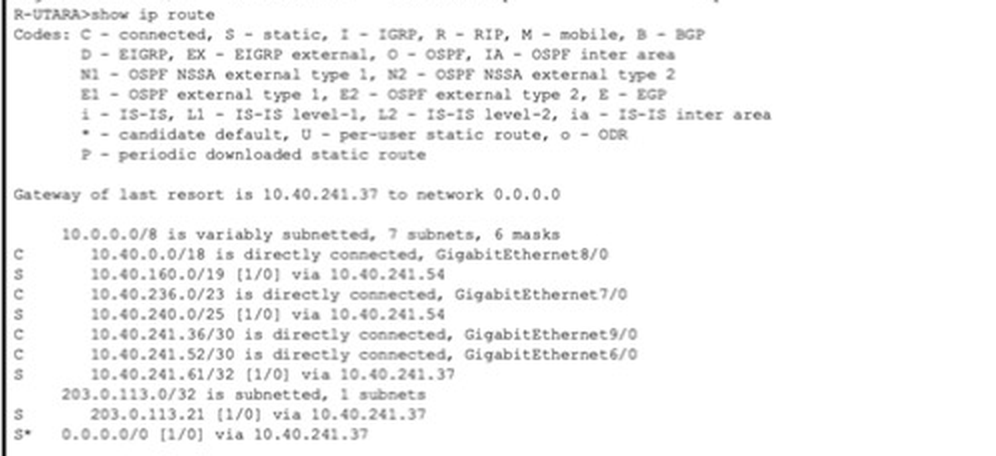

5. **`show ip route` pada R-DC**:
   Hanya default route ke R-PUSAT (`10.40.241.33`).

   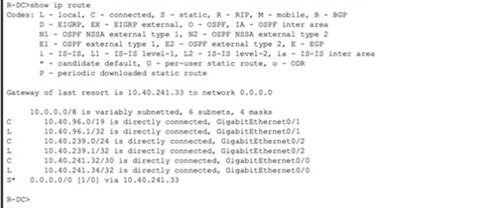

6. **`show ip route` pada R-PELABUHAN**:
   Hanya default route ke R-UTARA (`10.40.241.53`).

   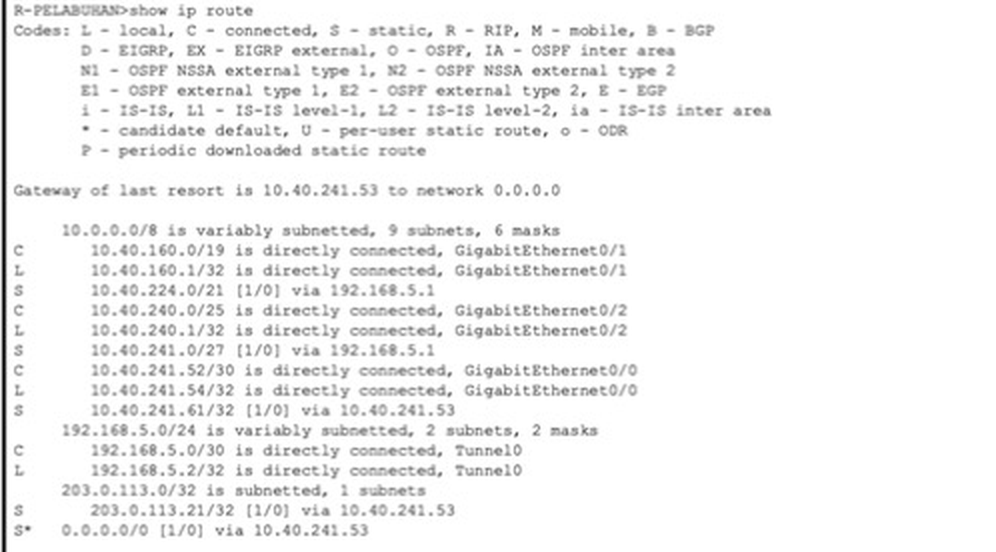

7. **`show startup-config` pada salah satu router**:
   Konfigurasi tampil (bukan pesan _startup-config is not present_), membuktikan `write memory` sudah dijalankan.

   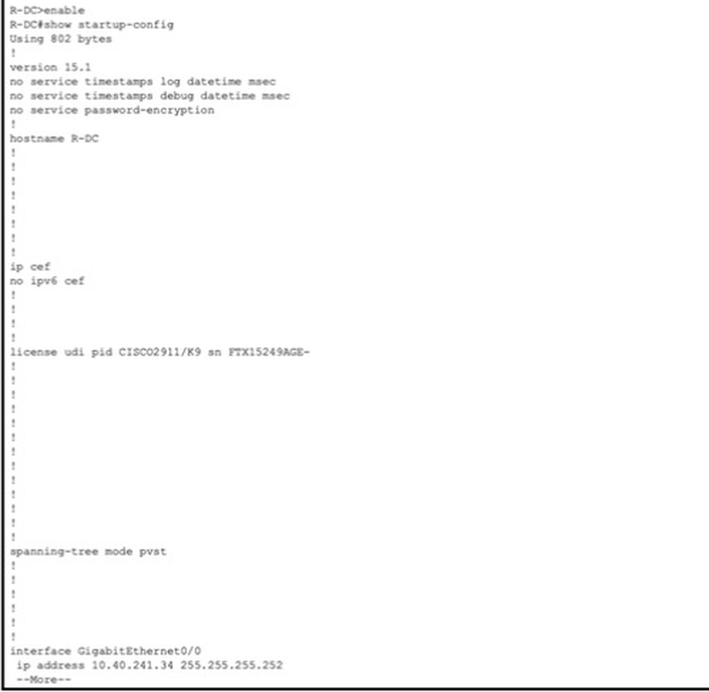

### 4.2 Ping antar-router (satu link)

| Dari    | Ke               | IP tujuan    | Hasil    |
| :------ | :--------------- | :----------- | :------- |
| R-PUSAT | R-DC (L1)        | 10.40.241.34 | Berhasil |
| R-PUSAT | R-UTARA (L2)     | 10.40.241.38 | Berhasil |
| R-PUSAT | R-SELATAN (L3)   | 10.40.241.42 | Berhasil |
| R-PUSAT | R-TIMUR (L4)     | 10.40.241.46 | Berhasil |
| R-PUSAT | R-BARAT (L5)     | 10.40.241.50 | Berhasil |
| R-PUSAT | R-ISP            | 203.0.113.22 | Berhasil |
| R-UTARA | R-PELABUHAN (L6) | 10.40.241.54 | Berhasil |

#### Bukti Pengujian:

1. **Ping backbone dari R-PUSAT dan R-UTARA**:
   Ping dari R-PUSAT ke L1 sampai L5 dan R-ISP, serta dari R-UTARA ke R-PELABUHAN, seluruhnya `!!!!!`.

   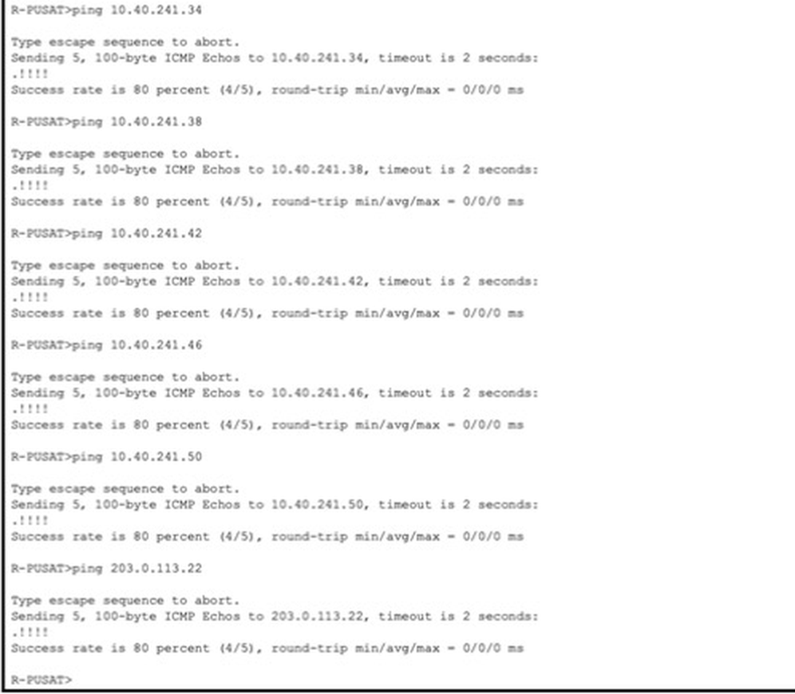

### 4.3 Ping lintas router (membuktikan static route)

Tujuan berupa alamat gateway LAN di router lain, sehingga paket harus melewati beberapa router.

| Dari        | Ke LAN                      | IP tujuan   | Jalur                                   | Hasil    |
| :---------- | :-------------------------- | :---------- | :-------------------------------------- | :------- |
| R-PUSAT     | CCTV Kota                   | 10.40.96.1  | R-DC langsung                           | Berhasil |
| R-PUSAT     | WiFi Publik Utara           | 10.40.0.1   | R-UTARA langsung                        | Berhasil |
| R-PUSAT     | Sensor dan SCADA Pelabuhan  | 10.40.160.1 | R-UTARA lalu R-PELABUHAN                | Berhasil |
| R-PELABUHAN | Pegawai Balai Kota          | 10.40.224.1 | naik ke R-UTARA lalu R-PUSAT            | Berhasil |
| R-DC        | WiFi Publik Selatan         | 10.40.64.1  | naik ke R-PUSAT lalu turun ke R-SELATAN | Berhasil |
| R-SELATAN   | WiFi Publik Barat           | 10.40.192.1 | naik ke R-PUSAT lalu turun ke R-BARAT   | Berhasil |
| R-TIMUR     | Puskesmas dan Sekolah Barat | 10.40.238.1 | naik ke R-PUSAT lalu turun ke R-BARAT   | Berhasil |

#### Bukti Pengujian:

1. **Ping lintas router dari CLI router**:
   Ping ke gateway LAN di router lain membuktikan static route berjalan.

   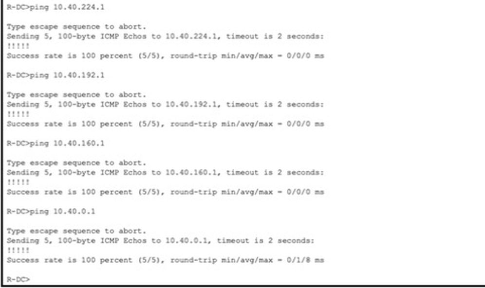

2. **Ping dari PC ke PC di wilayah berbeda**:
   Contoh dari `PC-PEGAWAI-BALAIKOTA` ke `PC-SCADA-PELABUHAN`.

   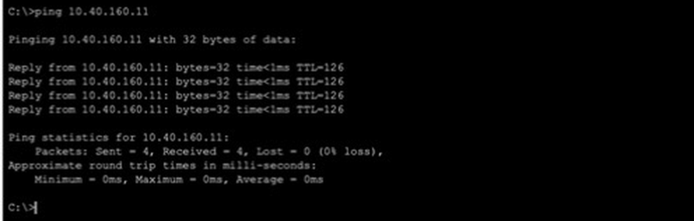

### 4.4 Akses keluar dan default route

| Tes                         | Hasil yang diharapkan                               | Hasil                 |
| :-------------------------- | :-------------------------------------------------- | :-------------------- |
| `ping 8.8.8.8` dari R-ISP   | Reply (server internet hidup)                       | Berhasil              |
| `ping 8.8.8.8` dari R-PUSAT | Reply (default route R-PUSAT ke R-ISP berjalan)     | Berhasil              |
| `ping 10.40.0.1` dari R-ISP | Tidak ada reply (R-ISP tanpa route ke 10.40.0.0/16) | Gagal, sesuai harapan |

Ping dari PC ke 8.8.8.8 baru bisa setelah DHCP dan NAT (soal 4 dan 5, Anggota 2) selesai; itu di luar bagian ini.

#### Bukti Pengujian:

1. **Ping 8.8.8.8 dari R-PUSAT dan ping 10.40.0.1 dari R-ISP**:
   Ping dari `R-PUSAT` berhasil, sedangkan ping dari `R-ISP` ke alamat privat gagal sesuai syarat soal 5.

   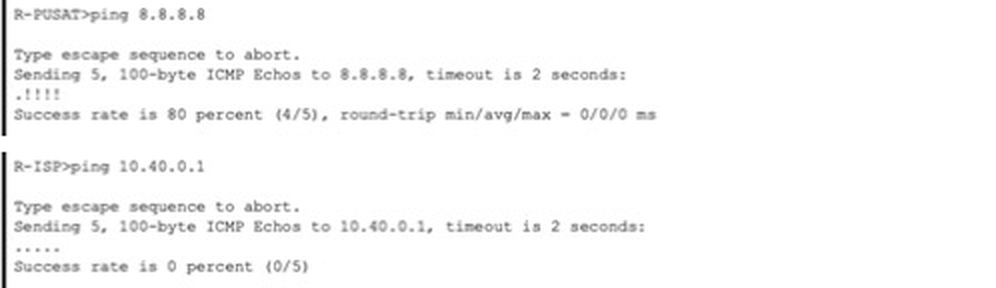

2. **`show ip route` pada R-ISP**:
   Tidak ada route ke blok `10.40.0.0/16` (hanya connected `203.0.113.20/30` dan `8.8.8.0/24`).

   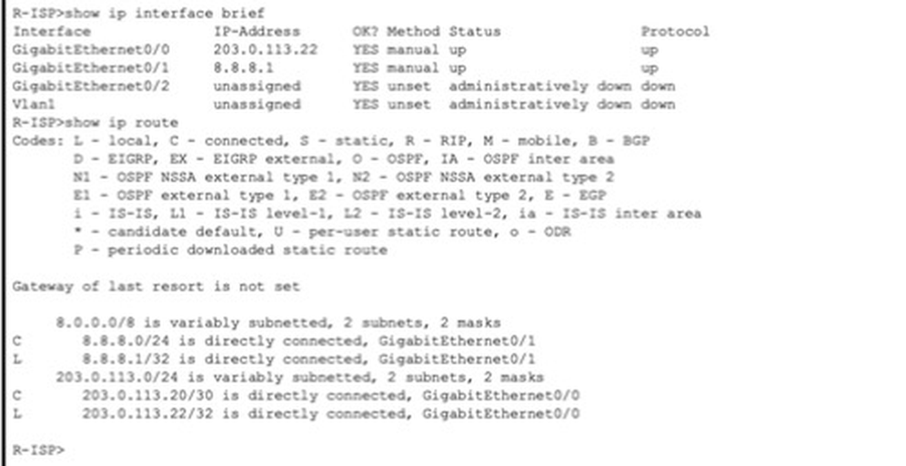

### 4.5 Bukti Pengujian Soal 1 dan Soal 2

#### Bukti Pengujian:

1. **Modul port R-PUSAT**:
   Tab _Physical_ `R-PUSAT` menampilkan dua modul HWIC-4ESW terpasang (bukti penambahan port).

   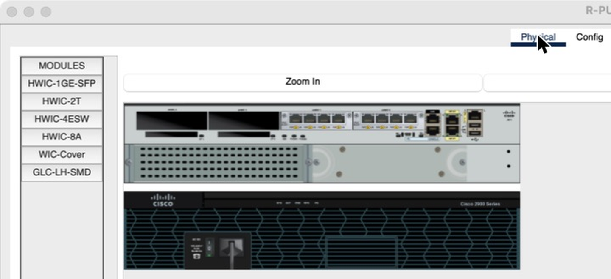

2. **Modul port R-UTARA**:
   Tab _Physical_ `R-UTARA` menampilkan modul port tambahan.

   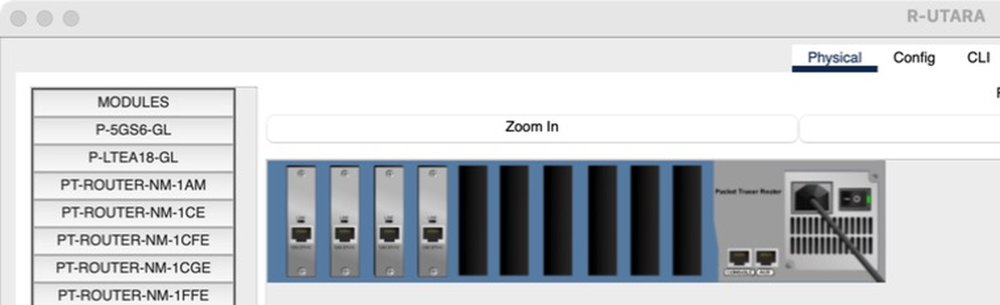

3. **Tabel subnetting VLSM pada spreadsheet**:
   Sheet _VLSM_ berisi nama subnet, network ID, prefix, rentang host, broadcast, dan gateway.

   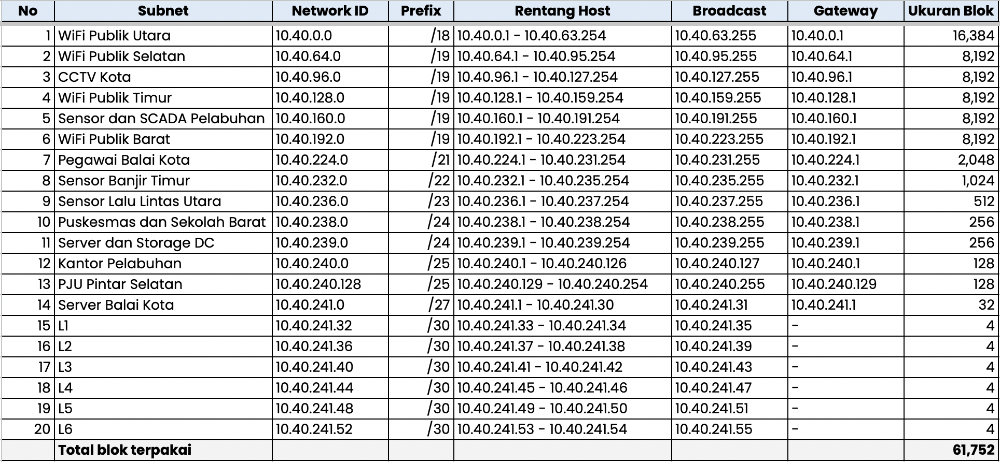

4. **Tabel revisi pada spreadsheet**:
   Sheet _Revisi_ berisi perbaikan terhadap lembar jawaban UTS beserta alasannya.

   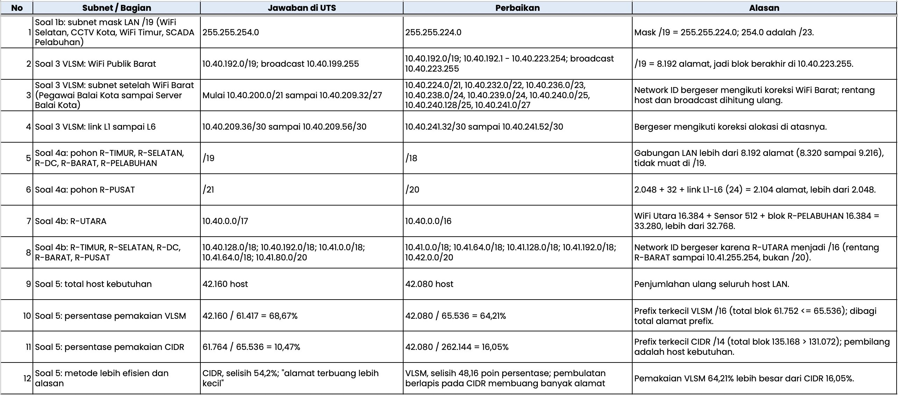

---

## 5. Catatan Perubahan: R-PUSAT Diganti ke 2911

Pada pengerjaan awal, R-PUSAT memakai Router-PT (PT1000, IOS 12.2) dengan port `Gi0/0`, `Gi1/0` sampai `Gi7/0`. Model ini **tidak mendukung `interface Tunnel`**, padahal soal 6 meminta tunnel GRE antara R-PUSAT dan R-PELABUHAN. Karena itu R-PUSAT diganti menjadi Cisco 2911 (IOS 15.1) dengan 2 modul HWIC-4ESW.

### 5.1 Pemetaan port

| Link        | Port fisik | Interface ber-IP | IP           | Terhubung ke           |
| :---------- | :--------- | :--------------- | :----------- | :--------------------- |
| ISP         | Gi0/0      | Gi0/0            | 203.0.113.21 | R-ISP Gi0/0            |
| LAN Pegawai | Gi0/1      | Gi0/1            | 10.40.224.1  | SW-BALAIKOTA Fa0/1     |
| L2          | Gi0/2      | Gi0/2            | 10.40.241.37 | R-UTARA Gi9/0          |
| L1          | Fa0/0/0    | Vlan11           | 10.40.241.33 | R-DC Gi0/0             |
| LAN Server  | Fa0/0/1    | Vlan12           | 10.40.241.1  | SW-SRV-BALAIKOTA Fa0/1 |
| L3          | Fa0/0/2    | Vlan13           | 10.40.241.41 | R-SELATAN Gi0/0        |
| L4          | Fa0/0/3    | Vlan14           | 10.40.241.45 | R-TIMUR Gi0/0          |
| L5          | Fa0/1/0    | Vlan15           | 10.40.241.49 | R-BARAT Gi0/0          |

### 5.2 Alasan dan cara kerja

- Modul HWIC-4ESW berisi port switch (bukan port routed). Setiap port diset `switchport mode access` pada VLAN tersendiri, lalu IP link /30 dipasang di `interface Vlan11` sampai `Vlan15`. Dengan satu port per VLAN, tiap interface VLAN berperilaku seperti port router biasa.
- Modul HWIC-1GE-SFP tidak dipakai untuk L5 karena port-nya fiber dan tidak bisa disambung ke port tembaga R-BARAT. Karena itu dipakai modul HWIC-4ESW kedua.
- Alamat IP, hostname, DHCP pool Pegawai (`POOL-PEGAWAI`), NAT overload, access-list 1, dan 13 static route (plus default route) R-PUSAT **tidak berubah**. Hanya nama interface yang berubah, dan pada konfigurasi akhir link L2 berada di `Gi0/2` sedangkan LAN Server di `Vlan12` (`Fa0/0/1`). Pada tabel routing, jaringan link L1-L5 kini berstatus connected lewat Vlan11 sampai Vlan15.
- Router lain (R-DC, R-UTARA, R-SELATAN, R-TIMUR, R-BARAT, R-PELABUHAN, R-ISP) tidak diubah sama sekali; tabel routing dan DHCP tetap sama, dan ping lintas LAN yang diuji tetap berhasil setelah penggantian.
- Konfigurasi VLAN dibuat dengan `vlan database` (di Packet Tracer ini perintah `vlan N` pada mode konfigurasi tidak diterima).

### 5.3 Catatan untuk pengerjaan berikutnya

- **Tunnel GRE (Anggota 2):** R-PUSAT sekarang mendukung `interface Tunnel0` (dikerjakan pada Bagian 8). Tunnel source memakai `Gi0/2` (`10.40.241.37`), yaitu sisi R-PUSAT pada link L2 ke R-UTARA.
- **OSPF (Anggota 3):** di R-PUSAT, interface LAN (`Gi0/1` dan `Vlan12`) dijadikan passive; `Gi0/2` (L2) serta `Vlan11`, `Vlan13`, `Vlan14`, dan `Vlan15` adalah backbone sehingga tidak boleh passive. Pernyataan `network` tetap berdasarkan alamat link /30.
- **Link L7 (Anggota 3):** `R-DC` (2911) sudah memakai ketiga port Gigabit bawaan, sehingga link L7 memakai modul port tambahan (lihat bagian Dynamic Routing OSPF Anggota 3). Jalankan `write memory` sebelum memasang modul karena router restart dan konfigurasi yang belum disimpan hilang.

---

## 6. Pengalamatan Dinamis (DHCP Server dan DHCP Relay)

Pada Bagian 2.3 draf Anggota 1, perangkat pengguna (PC kerja, laptop WiFi, dan kamera CCTV) sengaja belum diberi alamat IP statis. Pengalamatan seluruh perangkat tersebut diotomatisasi menggunakan protokol DHCP dengan dua metode:

1. **DHCP Server Lokal pada Router**: Melayani host pada LAN Pegawai Balai Kota, WiFi Publik Barat, dan Puskesmas.
2. **DHCP Relay pada Router & Server Terpusat**: Melayani kamera pengawas pada LAN CCTV Kota yang dialokasikan dari server Data Center (`SRV-DC`).

---

### 6.1 Konfigurasi DHCP Server Lokal pada Router

Router Cisco menyediakan layanan DHCP terintegrasi. Setiap pool dipetakan ke network LAN masing-masing, dengan reservasi 10 alamat IP pertama (`excluded-address`) untuk antarmuka gateway router, switch, maupun kebutuhan perangkat statis lain agar tidak terjadi konflik alamat IP (_IP conflict_).

#### A. Router R-PUSAT (LAN Pegawai Balai Kota)

Router `R-PUSAT` melayani pemberian alamat IP otomatis untuk komputer pegawai di Balai Kota pada segmen `10.40.224.0/21`:

```cisco
! Reservasi 10 IP pertama
ip dhcp excluded-address 10.40.224.1 10.40.224.10

! Konfigurasi pool pegawai Balai Kota
ip dhcp pool POOL-PEGAWAI
 network 10.40.224.0 255.255.248.0
 default-router 10.40.224.1
 dns-server 10.40.239.2
```

- `network 10.40.224.0 255.255.248.0`: Menyediakan rentang alamat IP subnet `/21` (kapasitas 2.046 host).
- `default-router 10.40.224.1`: Memberikan parameter Option 3 (_Default Gateway_) mengarah ke port `Gi0/1` R-PUSAT.
- `dns-server 10.40.239.2`: Mengarahkan resolusi nama domain ke server `SRV-DC`.

---

#### B. Router R-BARAT (WiFi Publik Barat dan Puskesmas)

Router `R-BARAT` mengelola dua pool terpisah untuk membedakan segmen publik dan instansi kesehatan:

```cisco
! Reservasi IP infrastruktur
ip dhcp excluded-address 10.40.192.1 10.40.192.10
ip dhcp excluded-address 10.40.238.1 10.40.238.10

! Pool layanan nirkabel WiFi Publik Barat
ip dhcp pool POOL-WIFI-BARAT
 network 10.40.192.0 255.255.224.0
 default-router 10.40.192.1
 dns-server 10.40.239.2

! Pool fasilitas kesehatan Puskesmas
ip dhcp pool POOL-PUSKESMAS
 network 10.40.238.0 255.255.255.0
 default-router 10.40.238.1
 dns-server 10.40.239.2
```

- Permintaan DHCP yang masuk melalui port `Gi0/1` (`10.40.192.1`) otomatis dialokasikan dari `POOL-WIFI-BARAT` (`/19`).
- Permintaan DHCP yang masuk melalui port `Gi0/2` (`10.40.238.1`) otomatis dialokasikan dari `POOL-PUSKESMAS` (`/24`).

---

### 6.2 Konfigurasi DHCP Relay Khusus CCTV (R-DC dan SRV-DC)

Kamera pengawas perkotaan (`PC-CCTV-KOTA`) berada di LAN `10.40.96.0/19` yang terhubung ke port `Gi0/1` router `R-DC`. Sesuai pembagian tugas, pengelolaan sewa IP CCTV dipusatkan pada server Data Center **`SRV-DC`** (`10.40.239.2`) di port `Gi0/2`.

Karena pesan _DHCP Discover_ dikirimkan secara broadcast layer 2/3 (`255.255.255.255`), paket tersebut dibuang (_dropped_) oleh router `R-DC`. Router `R-DC` harus dikonfigurasi sebagai **DHCP Relay Agent** menggunakan perintah `ip helper-address`.

#### A. Konfigurasi Relay pada Router R-DC

```cisco
interface GigabitEthernet0/1
 ip address 10.40.96.1 255.255.224.0
 ip helper-address 10.40.239.2
 duplex auto
 speed auto
!
interface GigabitEthernet0/2
 ip address 10.40.239.1 255.255.255.0
 duplex auto
 speed auto
```

**Cara Kerja Relay:**

1. Klien CCTV memancarkan broadcast _DHCP Discover_.
2. Port `Gi0/1` mencegat paket broadcast dan mengubahnya menjadi paket **unicast** dengan tujuan `10.40.239.2` (`SRV-DC`).
3. `R-DC` menyisipkan alamat IP antarmuka penerimanya (`10.40.96.1`) ke dalam field **GIADDR** (_Gateway IP Address_).
4. `SRV-DC` membaca nilai GIADDR tersebut, mencocokkannya dengan pool `CCTV` (`10.40.96.0/19`), dan mengirimkan penawaran IP (_DHCP Offer_) kembali secara unicast ke `R-DC`.

#### B. Konfigurasi Layanan DHCP pada Server SRV-DC

Pada menu GUI **Services > DHCP** di `SRV-DC`:

- Service: **On**
- Pool Name: `CCTV`
- Default Gateway: `10.40.96.1`
- DNS Server: `10.40.239.2`
- Start IP Address: `10.40.96.0` (penyewaan host dimulai dari `10.40.96.11`)
- Subnet Mask: `255.255.224.0`
- Maximum Number of Users: `250`

---

### 6.3 Hasil Pengujian DHCP

Seluruh komputer pengguna berhasil memperoleh konfigurasi IP dinamis secara tepat tanpa adanya tumpang tindih.

| Perangkat Klien          | Subnet LAN       | IP Diperoleh   | Gateway       | DHCP Server             | Keterangan Hasil                  |
| :----------------------- | :--------------- | :------------- | :------------ | :---------------------- | :-------------------------------- |
| **PC-PEGAWAI-BALAIKOTA** | `10.40.224.0/21` | `10.40.224.11` | `10.40.224.1` | `10.40.224.1` (R-PUSAT) | Berhasil disewakan via DHCP lokal |
| **PC-PUSKESMAS**         | `10.40.238.0/24` | `10.40.238.11` | `10.40.238.1` | `10.40.238.1` (R-BARAT) | Berhasil disewakan via DHCP lokal |
| **PC-CCTV-KOTA**         | `10.40.96.0/19`  | `10.40.96.11`  | `10.40.96.1`  | `10.40.239.2` (SRV-DC)  | Berhasil disewakan via DHCP Relay |

#### Bukti Pengujian:

1. **Konfigurasi & Binding DHCP pada Router R-BARAT**:
   Menampilkan konfigurasi pool `POOL-WIFI-BARAT` dan `POOL-PUSKESMAS`. Tabel `show ip dhcp binding` mencatat IP `10.40.192.11` dan `10.40.238.11` terikat secara otomatis (_Automatic_).

   

2. **Konfigurasi Pool Pegawai pada Router R-PUSAT**:
   Konfigurasi `POOL-PEGAWAI` serta tabel sewa IP awal.

   

3. **Detail Status Binding pada Router R-PUSAT**:
   Memastikan MAC Address komputer pegawai (`00E0.A3B4.8363`) terikat aktif pada alamat `10.40.224.11`.

   

4. **Verifikasi `ipconfig /all` pada PC-PEGAWAI-BALAIKOTA**:
   Klien menerima IP `10.40.224.11`, netmask `255.255.248.0`, gateway `10.40.224.1`, dan DNS `10.40.239.2`.

   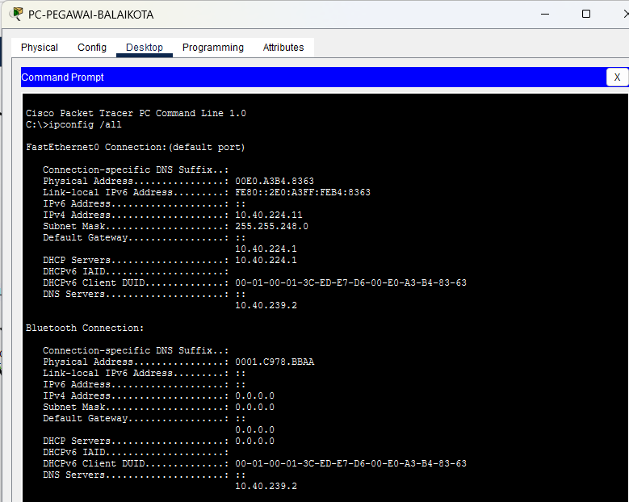

5. **Verifikasi `ipconfig /all` pada PC-PUSKESMAS**:
   Klien menerima IP `10.40.238.11`, netmask `255.255.255.0`, gateway `10.40.238.1`, dan DNS `10.40.239.2`.

   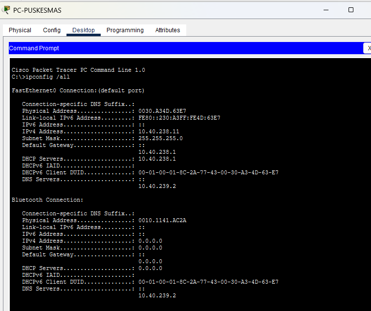

6. **Konfigurasi Service DHCP Pool CCTV pada SRV-DC**:
   Tampilan parameter service DHCP untuk subnet CCTV pada server Data Center.

   

7. **Konfigurasi `ip helper-address` pada Interface R-DC**:
   Potongan running-config antarmuka `Gi0/1` R-DC yang menjalankan peran DHCP Relay ke `10.40.239.2`.


8. **Verifikasi `ipconfig /all` pada PC-CCTV-KOTA (Pembuktian Relay)**:
   Klien CCTV memperoleh IP `10.40.96.11` dengan gateway `10.40.96.1`, dan field **DHCP Server** tertulis **`10.40.239.2`**. Ini membuktikan secara langsung bahwa paket DHCP berhasil diseberangkan lintas router dari Data Center.

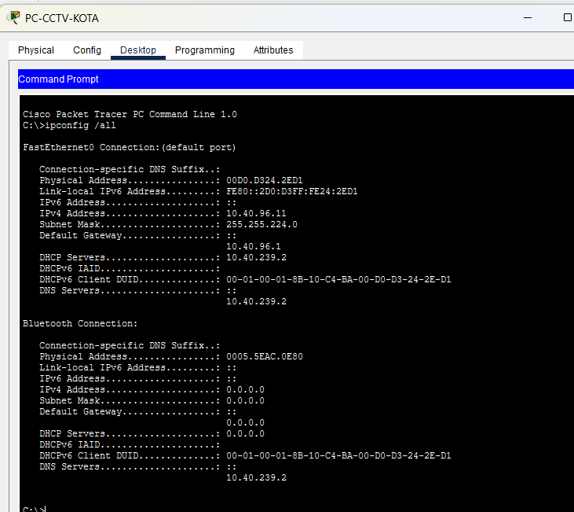

---

## 7. Network Address Translation (NAT) untuk Akses 8.8.8.8

### 7.1 Alasan dan Konfigurasi NAT di R-PUSAT

Pada pengujian Bagian 4.4 draf Anggota 1, ping dari router `R-PUSAT` ke server internet `8.8.8.8` telah berhasil, namun pengujian dari PC pengguna belum bisa dilakukan. Hal ini disebabkan oleh:

- Seluruh host internal memakai alamat IPv4 privat RFC 1918 (`10.40.0.0/16`).
- Router `R-ISP` sengaja tidak memiliki tabel routing ke blok alamat privat `10.40.0.0/16`.

Agar paket balasan dari internet dapat kembali ke host pengirim, router `R-PUSAT` dikonfigurasi dengan **NAT Overload / PAT (Port Address Translation)** pada antarmuka uplink WAN:

```cisco
! 1. Interface luar (Outside) menghadap ke ISP
interface GigabitEthernet0/0
 ip address 203.0.113.21 255.255.255.252
 ip nat outside

! 2. Interface dalam (Inside) menghadap ke LAN Balai Kota dan Backbone
interface GigabitEthernet0/1
 ip address 10.40.224.1 255.255.248.0
 ip nat inside

interface GigabitEthernet0/2
 ip address 10.40.241.37 255.255.255.252
 ip nat inside

! 3. ACL mengidentifikasi seluruh subnet privat internal
access-list 1 permit 10.40.0.0 0.0.255.255

! 4. Translasi dinamis overload ke IP publik port Gi0/0
ip nat inside source list 1 interface GigabitEthernet0/0 overload

! 5. Default route keluar menuju ISP (melanjutkan Bagian 3.1 Anggota 1)
ip route 0.0.0.0 0.0.0.0 203.0.113.22
```

**Penjelasan Perintah:**

- `ip nat outside`: Menetapkan `Gi0/0` sebagai gerbang keluar publik menuju `R-ISP`.
- `ip nat inside`: Menetapkan antarmuka LAN lokal dan interkoneksi transit sebagai zona asal paket privat.
- `overload`: Mengizinkan seluruh perangkat privat berbagi satu alamat IP publik `203.0.113.21` dengan membedakan sesi berdasarkan port layer 4 dan identifier ICMP.

---

### 7.2 Hasil Pengujian NAT

Akses internet dari perangkat pengguna diuji dari `PC-PEGAWAI-BALAIKOTA` menuju `8.8.8.8`:

| Pengujian                  | Sumber                                | Tujuan    | Hasil yang Diharapkan                                     | Hasil Pengujian |
| :------------------------- | :------------------------------------ | :-------- | :-------------------------------------------------------- | :-------------- |
| `ping 8.8.8.8`             | PC-PEGAWAI-BALAIKOTA (`10.40.224.11`) | `8.8.8.8` | Reply 4/4 (_0% loss_)                                     | **Berhasil**    |
| `show ip nat translations` | R-PUSAT CLI                           | N/A       | Entri translasi `10.40.224.11` -> `203.0.113.21` tercatat | **Berhasil**    |

#### Bukti Pengujian:

1. **Konfigurasi Interface NAT R-PUSAT**:
   Potongan running-config `R-PUSAT` membuktikan status `ip nat outside` pada `Gi0/0` serta `ip nat inside` pada `Gi0/1` dan `Gi0/2`.

   

2. **Uji Ping ke 8.8.8.8 dari PC Pegawai Balai Kota**:
   Empat paket ICMP dijawab lengkap dengan waktu tempuh `<1ms` dan `TTL=126`.

   

3. **Verifikasi Tabel `show ip nat translations` pada R-PUSAT**:
   Tabel membuktikan alamat **Inside Local** `10.40.224.11` ditranslasikan secara dinamis menjadi alamat **Inside Global** `203.0.113.21` untuk menjangkau destinasi **Outside Global** `8.8.8.8`.

   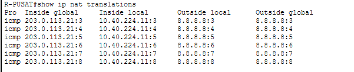

---

## 8. GRE Tunnel antara Balai Kota dan Pelabuhan

### 8.1 Desain dan Konfigurasi Interface Tunnel0

Sesuai catatan Bagian 5 draf Anggota 1, penggantian `R-PUSAT` ke router Cisco 2911 (IOS 15.1) memungkinkan pembuatan antarmuka virtual `interface Tunnel0`. Jalur ini menghubungkan Balai Kota (`R-PUSAT`) dan Pelabuhan (`R-PELABUHAN`) secara _point-to-point_ privat di atas infrastruktur transit yang ada.

#### Parameter Konfigurasi Tunnel0:

| Parameter              | Router R-PUSAT (Balai Kota)                   | Router R-PELABUHAN (Pelabuhan)                | Alasan Teknis                                      |
| :--------------------- | :-------------------------------------------- | :-------------------------------------------- | :------------------------------------------------- |
| **Interface Virtual**  | `Tunnel0`                                     | `Tunnel0`                                     | Port logis terowongan virtual GRE                  |
| **Alamat IP Tunnel**   | `192.168.5.1 255.255.255.252`                 | `192.168.5.2 255.255.255.252`                 | Subnet `/30` Kelompok 5 ($K = 5$)                  |
| **MTU**                | `1476`                                        | `1476`                                        | Mencegah fragmentasi akibat overhead GRE (24 byte) |
| **Tunnel Source**      | `GigabitEthernet0/2` (atau IP `10.40.241.37`) | `GigabitEthernet0/0` (atau IP `10.40.241.54`) | Titik awal pengiriman paket underlay               |
| **Tunnel Destination** | `10.40.241.54` (IP fisik R-PELABUHAN)         | `10.40.241.37` (IP fisik R-PUSAT)             | Titik akhir tujuan pengiriman paket underlay       |

```cisco
! Konfigurasi di R-PUSAT
interface Tunnel0
 ip address 192.168.5.1 255.255.255.252
 mtu 1476
 tunnel source GigabitEthernet0/2
 tunnel destination 10.40.241.54

! Konfigurasi di R-PELABUHAN
interface Tunnel0
 ip address 192.168.5.2 255.255.255.252
 mtu 1476
 tunnel source GigabitEthernet0/0
 tunnel destination 10.40.241.37
```

**Alasan Penetapan MTU 1476 Byte:**
Ukuran MTU Ethernet standar adalah 1500 byte. GRE menambahkan header pembungkus sebesar 24 byte (20 byte IPv4 outer header + 4 byte GRE header). Mengatur MTU menjadi $1500 - 24 = 1476$ byte memastikan paket berukuran maksimal tidak mengalami pemotongan/fragmentasi (_IP fragmentation_) di sepanjang jalur transit.

---

### 8.2 Pembaruan Rute Statis Melintasi Tunnel (Penggantian Rute Anggota 1)

Pada Bagian 3.1 draf Anggota 1 tercatat:

> _"route R-PUSAT ke LAN Pelabuhan lewat R-UTARA (10.40.241.38) akan diganti ke tunnel GRE pada soal 6 (Anggota 2)."_

Sesuai instruksi tersebut, tabel routing statis diperbarui:

1. **Pembaruan di R-PUSAT**:
   Rute lama ke LAN Pelabuhan via next-hop R-UTARA (`10.40.241.38`) dialihkan ke next-hop IP Tunnel `192.168.5.2`:

   ```cisco
   ip route 10.40.160.0 255.255.224.0 192.168.5.2
   ip route 10.40.240.0 255.255.255.128 192.168.5.2
   ```

2. **Penambahan di R-PELABUHAN**:
   Rute spesifik menuju LAN Balai Kota diarahkan melalui next-hop IP Tunnel `192.168.5.1`:
   ```cisco
   ip route 10.40.224.0 255.255.248.0 192.168.5.1
   ip route 10.40.241.0 255.255.255.224 192.168.5.1
   ```

Dengan konfigurasi ini, seluruh paket data antara Balai Kota dan Pelabuhan langsung masuk ke terowongan enkapsulasi GRE tanpa melalui pemrosesan routing biasa di router perantara `R-UTARA`.

---

### 8.3 Hasil Pengujian GRE Tunnel

| No  | Pengujian                  | Titik Uji                      | Target                        | Hasil yang Diharapkan                  | Hasil        |
| :-- | :------------------------- | :----------------------------- | :---------------------------- | :------------------------------------- | :----------- |
| 1   | Status Antarmuka Tunnel0   | R-PUSAT & R-PELABUHAN          | `Tunnel0`                     | Status `up/up`                         | **Berhasil** |
| 2   | Ping Antar-Endpoint Tunnel | R-PUSAT CLI                    | `192.168.5.2`                 | Reply 5/5 (`!!!!!`)                    | **Berhasil** |
| 3   | Ping Antar-Endpoint Tunnel | R-PELABUHAN CLI                | `192.168.5.1`                 | Reply 5/5 (`!!!!!`)                    | **Berhasil** |
| 4   | Verifikasi Rute Overlay    | R-PUSAT & R-PELABUHAN          | `show ip route`               | Prefix diarahkan via IP Tunnel         | **Berhasil** |
| 5   | Ping End-to-End Antar-LAN  | PC Balai Kota (`10.40.224.11`) | PC Pelabuhan (`10.40.160.11`) | Reply 4/4 (_0% loss_)                  | **Berhasil** |
| 6   | Traceroute Enkapsulasi     | PC Balai Kota (`10.40.224.11`) | PC Pelabuhan (`10.40.160.11`) | Hop 2 langsung IP Tunnel `192.168.5.2` | **Berhasil** |

#### Bukti Pengujian:

1. **Konfigurasi Interface Tunnel0 pada R-PUSAT**:
   Running-config antarmuka Tunnel0 dengan IP `192.168.5.1/30` dan MTU `1476`.

   

2. **Konfigurasi Interface Tunnel0 pada R-PELABUHAN**:
   Running-config antarmuka Tunnel0 dengan IP `192.168.5.2/30` dan MTU `1476`.

   

3. **Status Antarmuka Brief pada R-PUSAT**:
   Menunjukkan `Tunnel0` berstatus aktif normal (**up/up**).

   

4. **Status Antarmuka Brief pada R-PELABUHAN**:
   Menunjukkan `Tunnel0` berstatus aktif normal (**up/up**).

   

5. **Tabel Routing R-PUSAT Membuktikan Rute via Tunnel**:
   Output `show ip route` membuktikan rute `10.40.160.0/19` dan `10.40.240.0/25` diarahkan via `192.168.5.2`.

   

6. **Tabel Routing R-PELABUHAN Membuktikan Rute via Tunnel**:
   Output `show ip route` membuktikan rute `10.40.224.0/21` diarahkan via `192.168.5.1`.

   

7. **Ping Tunnel dari R-PUSAT ke R-PELABUHAN (`192.168.5.2`)**:
   Tingkat keberhasilan 100% (5/5 paket balasan diterima).

   

8. **Ping Tunnel dari R-PELABUHAN ke R-PUSAT (`192.168.5.1`)**:
   Tingkat keberhasilan 100% (5/5 paket balasan diterima).

   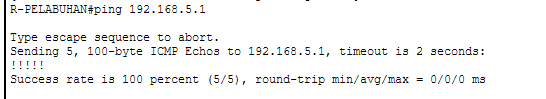

9. **Ping End-to-End dari PC Balai Kota ke PC Pelabuhan (`10.40.160.11`)**:
   Komunikasi antar komputer pengguna lintas pulau/kantor berhasil tanpa packet loss.

   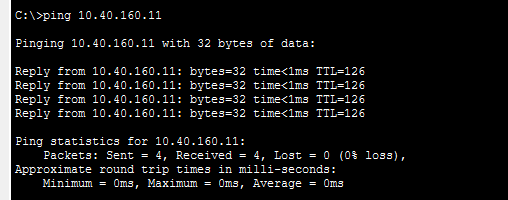

10. **Traceroute Membuktikan Jalur GRE Tunnel**:
    Eksekusi `tracert 10.40.160.11` dari `PC-PEGAWAI-BALAIKOTA`:

    

    ```text
    C:\>tracert 10.40.160.11

    Tracing route to 10.40.160.11 over a maximum of 30 hops:

      1   0 ms      0 ms      0 ms      10.40.224.1
      2   0 ms      0 ms      0 ms      192.168.5.2
      3   0 ms      0 ms      1 ms      10.40.160.11

    Trace complete.
    ```

# Laporan Mid-Project Jarkom - Kelompok 5

> Draf bagian **Anggota 3** (Verifikasi CIDR/VLSM, Server Aplikasi, dan Dynamic Routing OSPF).

## 1. Verifikasi Perhitungan CIDR & VLSM

### 1.1 Ringkasan Verifikasi & Perbandingan Efisiensi

Berdasarkan hasil verifikasi perhitungan pada spreadsheet kelompok (blok utama `10.40.0.0/16`, dengan nilai $K = 5$), dipilih skema **VLSM (Variable Length Subnet Mask)** dibandingkan alokasi blok tetap per router (CIDR).

- **Total Kebutuhan Host (14 LAN):** `42.080` host.
- **Skema VLSM (`10.40.0.0/16`):** Menyediakan kapasitas total `65.536` alamat ($2^{16}$). Seluruh 14 LAN dan 7 link _point-to-point_ (`/30`) muat dalam satu blok `/16` tanpa adanya _overlapping_ IP, menghasilkan tingkat efisiensi pemakaian sebesar **64,21%** ($\frac{42.080}{65.536} \times 100\%$).
- **Pembanding Skema CIDR (Blok Pangkat 2 per Router):** Apabila setiap router dialokasikan satu blok tunggal berbasis pangkat 2 tertinggi, total jaringan membutuhkan ruang sebesar blok `/14` (`262.144` alamat) dengan tingkat efisiensi hanya **16,05%** ($\frac{42.080}{262.144} \times 100\%$).

---

### 1.2 Tabel Verifikasi Alokasi Subnet LAN (VLSM)

Pengurutan alokasi dilakukan dari kebutuhan host terbesar hingga terkecil untuk mencegah tumpang tindih (_overlapping_) subnet:

|    No     | Router      | Jaringan / LAN              | Kebutuhan Host | Kapasitas Host ($2^n - 2$) | Network ID    | Prefix | Subnet Mask     | Gateway (Host 1) | Usable Host Range             | Broadcast     |
| :-------: | :---------- | :-------------------------- | :------------: | :------------------------: | :------------ | :----: | :-------------- | :--------------- | :---------------------------- | :------------ |
|     1     | R-UTARA     | WiFi Publik Utara           |     11.000     |           16.382           | 10.40.0.0     | `/18`  | 255.255.192.0   | 10.40.0.1        | 10.40.0.1 - 10.40.63.254      | 10.40.63.255  |
|     2     | R-SELATAN   | WiFi Publik Selatan         |     6.500      |           8.190            | 10.40.64.0    | `/19`  | 255.255.224.0   | 10.40.64.1       | 10.40.64.1 - 10.40.95.254     | 10.40.95.255  |
|     3     | R-DC        | CCTV Kota                   |     6.000      |           8.190            | 10.40.96.0    | `/19`  | 255.255.224.0   | 10.40.96.1       | 10.40.96.1 - 10.40.127.254    | 10.40.127.255 |
|     4     | R-TIMUR     | WiFi Publik Timur           |     5.500      |           8.190            | 10.40.128.0   | `/19`  | 255.255.224.0   | 10.40.128.1      | 10.40.128.1 - 10.40.159.254   | 10.40.159.255 |
|     5     | R-PELABUHAN | Sensor dan SCADA Pelabuhan  |     5.000      |           8.190            | 10.40.160.0   | `/19`  | 255.255.224.0   | 10.40.160.1      | 10.40.160.1 - 10.40.191.254   | 10.40.191.255 |
|     6     | R-BARAT     | WiFi Publik Barat           |     4.500      |           8.190            | 10.40.192.0   | `/19`  | 255.255.224.0   | 10.40.192.1      | 10.40.192.1 - 10.40.223.254   | 10.40.223.255 |
|     7     | R-PUSAT     | Pegawai Balai Kota          |     1.800      |           2.046            | 10.40.224.0   | `/21`  | 255.255.248.0   | 10.40.224.1      | 10.40.224.1 - 10.40.231.254   | 10.40.231.255 |
|     8     | R-TIMUR     | Sensor Banjir Timur         |      700       |           1.022            | 10.40.232.0   | `/22`  | 255.255.252.0   | 10.40.232.1      | 10.40.232.1 - 10.40.235.254   | 10.40.235.255 |
|     9     | R-UTARA     | Sensor Lalu Lintas Utara    |      450       |            510             | 10.40.236.0   | `/23`  | 255.255.254.0   | 10.40.236.1      | 10.40.236.1 - 10.40.237.254   | 10.40.237.255 |
|    10     | R-BARAT     | Puskesmas dan Sekolah Barat |      220       |            254             | 10.40.238.0   | `/24`  | 255.255.255.0   | 10.40.238.1      | 10.40.238.1 - 10.40.238.254   | 10.40.238.255 |
|    11     | R-DC        | Server dan Storage DC       |      180       |            254             | 10.40.239.0   | `/24`  | 255.255.255.0   | 10.40.239.1      | 10.40.239.1 - 10.40.239.254   | 10.40.239.255 |
|    12     | R-PELABUHAN | Kantor Pelabuhan            |      120       |            126             | 10.40.240.0   | `/25`  | 255.255.255.128 | 10.40.240.1      | 10.40.240.1 - 10.40.240.126   | 10.40.240.127 |
|    13     | R-SELATAN   | PJU Pintar Selatan          |       90       |            126             | 10.40.240.128 | `/25`  | 255.255.255.128 | 10.40.240.129    | 10.40.240.129 - 10.40.240.254 | 10.40.240.255 |
|    14     | R-PUSAT     | Server Balai Kota           |       20       |             30             | 10.40.241.0   | `/27`  | 255.255.255.224 | 10.40.241.1      | 10.40.241.1 - 10.40.241.30    | 10.40.241.31  |
| **Total** |             | **14 Segmen LAN**           |   **42.080**   |         **61.700**         |               |        |                 |                  |                               |               |

> **Catatan Alokasi Server & DHCP:**
>
> - Alamat `.1` pada setiap LAN dialokasikan sebagai **Default Gateway** di interface router.
> - Alamat `.2` pada LAN Server dialokasikan secara statis untuk server (`SRV-DC`: `10.40.239.2` dan `SRV-BALAIKOTA`: `10.40.241.2`).
> - Rentang `.1` hingga `.10` pada setiap LAN dikecualikan (`excluded-address`) dari DHCP pool untuk mencegah konflik IP.

---

### 1.3 Tabel Verifikasi Alokasi Link Backbone, ISP, Internet, & Tunnel GRE

Alokasi _point-to-point_ (`/30`) untuk koneksi antar-router mengambil blok kosong setelah subnet LAN terakhir (`10.40.241.32` ke atas):

| Link / Segmen          | Koneksi Perangkat                     | Network ID   | Prefix | Subnet Mask     | Usable Host Range           | Broadcast    | Pembagian IP Interface               |
| :--------------------- | :------------------------------------ | :----------- | :----: | :-------------- | :-------------------------- | :----------- | :----------------------------------- |
| **L1**                 | R-PUSAT $\leftrightarrow$ R-DC        | 10.40.241.32 | `/30`  | 255.255.255.252 | 10.40.241.33 - 10.40.241.34 | 10.40.241.35 | R-PUSAT (`.33`), R-DC (`.34`)        |
| **L2**                 | R-PUSAT $\leftrightarrow$ R-UTARA     | 10.40.241.36 | `/30`  | 255.255.255.252 | 10.40.241.37 - 10.40.241.38 | 10.40.241.39 | R-PUSAT (`.37`), R-UTARA (`.38`)     |
| **L3**                 | R-PUSAT $\leftrightarrow$ R-SELATAN   | 10.40.241.40 | `/30`  | 255.255.255.252 | 10.40.241.41 - 10.40.241.42 | 10.40.241.43 | R-PUSAT (`.41`), R-SELATAN (`.42`)   |
| **L4**                 | R-PUSAT $\leftrightarrow$ R-TIMUR     | 10.40.241.44 | `/30`  | 255.255.255.252 | 10.40.241.45 - 10.40.241.46 | 10.40.241.47 | R-PUSAT (`.45`), R-TIMUR (`.46`)     |
| **L5**                 | R-PUSAT $\leftrightarrow$ R-BARAT     | 10.40.241.48 | `/30`  | 255.255.255.252 | 10.40.241.49 - 10.40.241.50 | 10.40.241.51 | R-PUSAT (`.49`), R-BARAT (`.50`)     |
| **L6**                 | R-UTARA $\leftrightarrow$ R-PELABUHAN | 10.40.241.52 | `/30`  | 255.255.255.252 | 10.40.241.53 - 10.40.241.54 | 10.40.241.55 | R-UTARA (`.53`), R-PELABUHAN (`.54`) |
| **L7 (Cadangan OSPF)** | R-DC $\leftrightarrow$ R-UTARA        | 10.40.241.56 | `/30`  | 255.255.255.252 | 10.40.241.57 - 10.40.241.58 | 10.40.241.59 | R-DC (`.57`), R-UTARA (`.58`)        |
| **Link ISP**           | R-PUSAT $\leftrightarrow$ R-ISP       | 203.0.113.20 | `/30`  | 255.255.255.252 | 203.0.113.21 - 203.0.113.22 | 203.0.113.23 | R-PUSAT (`.21`), R-ISP (`.22`)       |
| **Internet Publik**    | R-ISP $\leftrightarrow$ SRV-INTERNET  | 8.8.8.0      | `/24`  | 255.255.255.0   | 8.8.8.1 - 8.8.8.254         | 8.8.8.255    | R-ISP (`.1`), SRV-INTERNET (`.8`)    |
| **Tunnel GRE**         | R-PUSAT $\leftrightarrow$ R-PELABUHAN | 192.168.5.0  | `/30`  | 255.255.255.252 | 192.168.5.1 - 192.168.5.2   | 192.168.5.3  | R-PUSAT (`.1`), R-PELABUHAN (`.2`)   |

---

## 2. Konfigurasi Layanan Server Aplikasi

Konfigurasi layanan dilakukan pada dua server utama, yaitu **SRV-DC** (`10.40.239.2`) dan **SRV-BALAIKOTA** (`10.40.241.2`).

### 2.1 DNS Server (SRV-DC)

Layanan DNS diaktifkan pada SRV-DC untuk menerjemahkan nama domain `k5.smartcity.lab` beserta subdomainnya ke alamat IP Server terkait.

| Nama Domain             | Tipe Record | IP Address Tujuan | Server Tujuan |
| :---------------------- | :---------: | :---------------- | :------------ |
| `k5.smartcity.lab`      |  A Record   | `10.40.241.2`     | SRV-BALAIKOTA |
| `www.k5.smartcity.lab`  |  A Record   | `10.40.241.2`     | SRV-BALAIKOTA |
| `ftp.k5.smartcity.lab`  |  A Record   | `10.40.239.2`     | SRV-DC        |
| `mail.k5.smartcity.lab` |  A Record   | `10.40.241.2`     | SRV-BALAIKOTA |

### 2.2 Web Smart City (SRV-BALAIKOTA)

Layanan HTTP/HTTPS diaktifkan, dan file `index.html` diedit untuk menampilkan Portal Smart City milik Kelompok 5.

### 2.3 FTP Server (SRV-DC)

Layanan FTP diaktifkan untuk penyimpanan data CCTV. Dibuat akun dengan _username_ `cctv` yang memiliki hak akses penuh (_Write, Read, Delete, Rename, List_).

### 2.4 Email Server (SRV-BALAIKOTA)

Layanan SMTP dan POP3 diaktifkan dengan nama domain `k5.smartcity.lab`. Dibuat akun pengguna `pegawai` (`pegawai@k5.smartcity.lab`) dan `pelabuhan` (`pelabuhan@k5.smartcity.lab`) untuk komunikasi antar-divisi.

---

## 3. Dynamic Routing OSPF & Link Cadangan L7

Bagian ini dikerjakan pada file terpisah (`K5_VLSM_OSPF.pkt`) untuk mensimulasikan redundansi jaringan. Seluruh _static route_ antar-router dihapus dan digantikan oleh protokol _dynamic routing_ OSPF.

### 3.1 Pemasangan Link Cadangan (L7)

Kabel cadangan L7 dipasang menggunakan port Gigabit Ethernet tambahan antara router **R-DC** dan **R-UTARA** dengan alokasi IP `10.40.241.56/30`.

- **R-DC (Fa0/0/0 via VLAN 17):** `10.40.241.57`
- **R-UTARA (Gi10/0):** `10.40.241.58`

### 3.2 Konfigurasi OSPF

OSPF diaktifkan (Process ID `1`) pada semua router. Jaringan didaftarkan menggunakan _wildcard mask_ di `area 0`. Antarmuka yang mengarah ke jaringan pengguna (LAN) diset sebagai `passive-interface` agar pembaruan OSPF tidak dikirim ke perangkat pengguna.

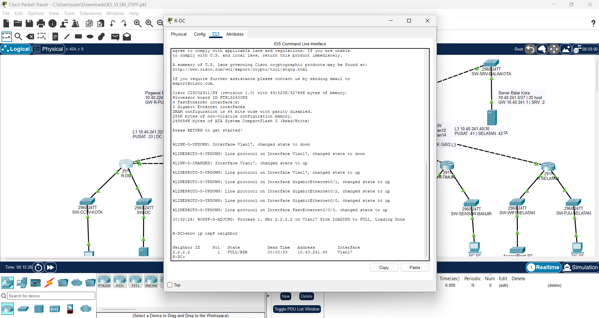
_Gambar: Verifikasi `show ip ospf neighbor` menunjukkan R-UTARA telah membentuk hubungan tetangga yang FULL dengan R-DC melalui link cadangan._


_Gambar: Tabel routing menunjukkan rute-rute dinamis yang ditandai dengan kode "O" (OSPF)._

---

## 4. Hasil Pengujian Layanan

Berikut adalah bukti bahwa layanan di _Application Layer_ berjalan dengan baik dan dapat diakses dari PC Klien menggunakan DNS.

### 4.1 Pengujian Web Server

Pengujian dilakukan dari `PC-PEGAWAI-BALAIKOTA` dengan mengakses URL `www.k5.smartcity.lab` melalui Web Browser.


### 4.2 Pengujian FTP

Pengujian dilakukan dari Command Prompt di `PC-CCTV-KOTA`. Berhasil melakukan _login_ dengan _username_ `cctv` ke alamat `ftp.k5.smartcity.lab`.


### 4.3 Pengujian Email

Pengujian dilakukan dengan mengirimkan pesan dari `PC-PEGAWAI-BALAIKOTA` (`pegawai@k5.smartcity.lab`) kepada `PC-KANTOR-PELABUHAN` (`pelabuhan@k5.smartcity.lab`) dan sebaliknya.

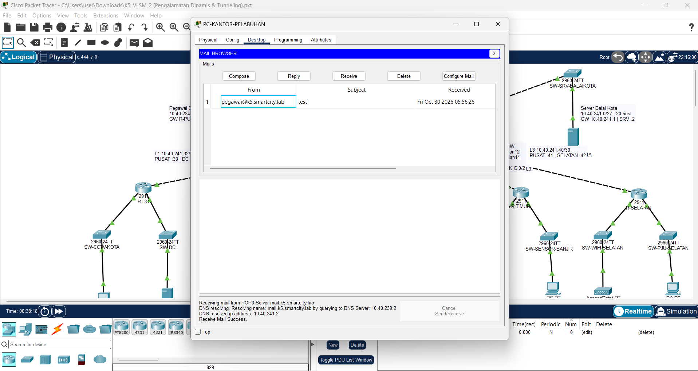

### 4.4 Pengujian Redundansi Jalur OSPF (Failover)

Saat link utama (`L1` atau `L2`) dimatikan secara paksa, OSPF secara otomatis mengalihkan jalur _routing_ melewati kabel cadangan `L7`, sehingga layanan PING dan komunikasi antar-LAN tetap berjalan setelah sempat terputus sesaat (_Request Timed Out_).

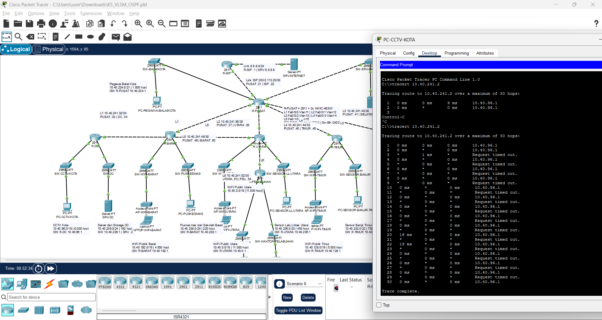
